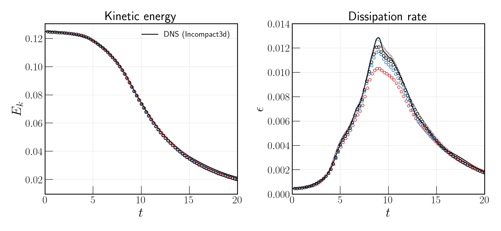
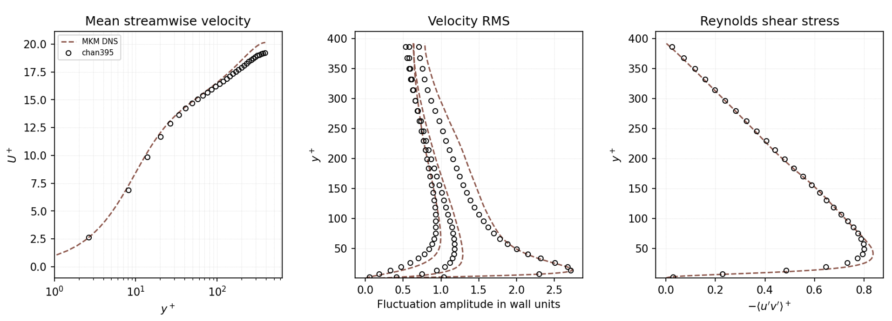
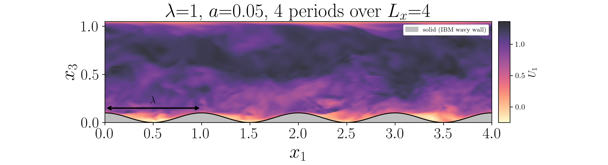
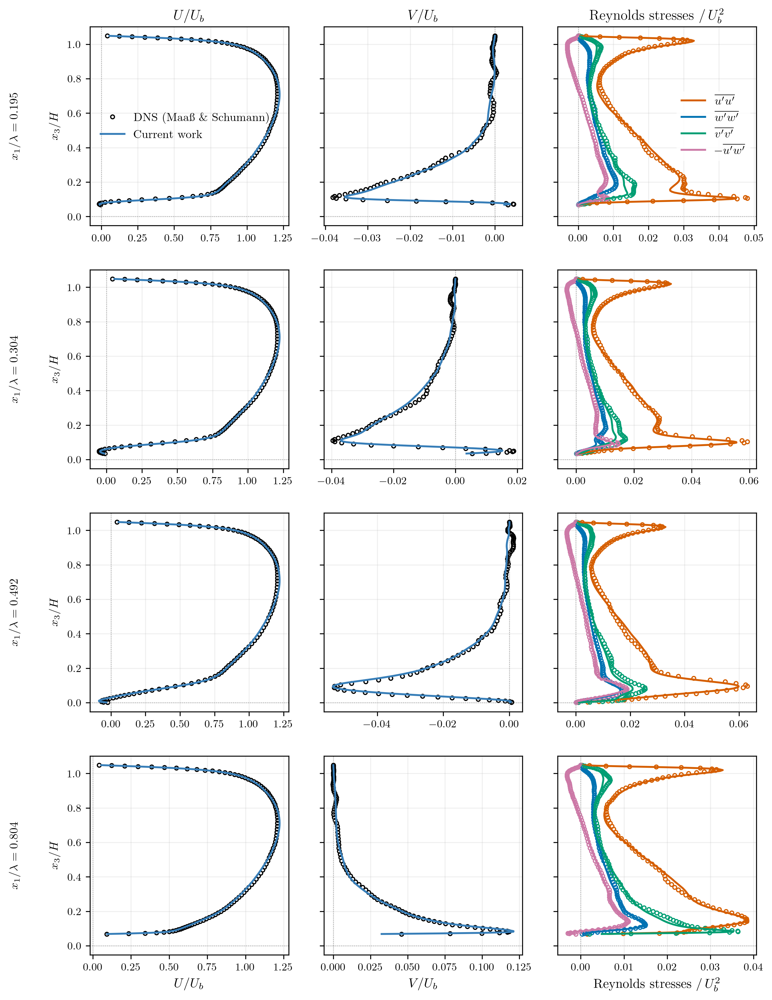
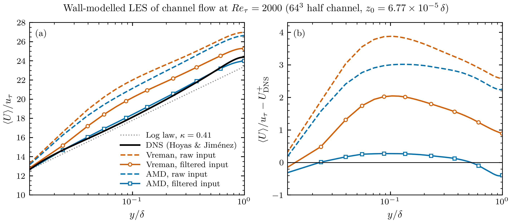
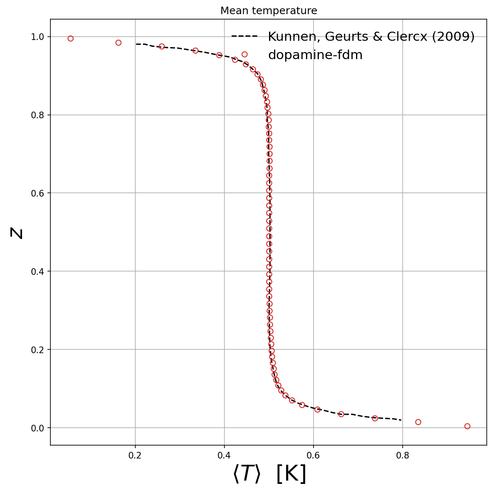

# Numerics & Governing Equations

[← Home](Home.md)

`dopamine-fdm` integrates the incompressible Navier–Stokes equations on distributed-memory
systems via MPI (2decomp&fft 2-D pencil decomposition, auto-preferring a 1-D z-slab split
when the rank count allows — see [§10](#10-mpi-parallelism)), supporting both direct
numerical simulation (DNS) and large-eddy simulation (LES).

## 1. Governing equations

$$\frac{\partial u_i}{\partial t} + \frac{\partial (u_i u_j)}{\partial x_j} = -\frac{1}{\rho}\frac{\partial p}{\partial x_i} + \frac{\partial}{\partial x_j}\left[(\nu + \nu_t)\left(\frac{\partial u_i}{\partial x_j} + \frac{\partial u_j}{\partial x_i}\right)\right] + f_i$$

$$\frac{\partial u_i}{\partial x_i} = 0$$

where $\nu$ is the kinematic viscosity, $\nu_t$ is the sub-grid scale (SGS) eddy
viscosity (zero for DNS), and $f_i$ is an imposed body force (typically a mean pressure
gradient).

Streamwise ($x$) and spanwise ($z$) forcing:

$$f_x(t) = \frac{\mathrm{d}P}{\mathrm{d}x}\bigg|_0 + U_{b,x}\omega_x\cos(\omega_x t + \varphi_x), \qquad f_z(t) = \frac{\mathrm{d}P}{\mathrm{d}z}\bigg|_0 + U_{b,z}\omega_z\cos(\omega_z t + \varphi_z)$$

where $\omega_x = 2\pi / T_{\mathrm{wave},x}$ and $\omega_z = 2\pi / T_{\mathrm{wave},z}$
are derived from the user-supplied wave periods, and $\varphi_x$, $\varphi_z$ are
optional phase offsets (radians, default 0). Setting $T_{\mathrm{wave},x} = 0$ (or
$T_{\mathrm{wave},z} = 0$) disables oscillation in that direction, recovering steady
forcing. Configured via `&PHYSICS` — see [Input Parameters](Input-Parameters.md#physics).

Alternatively, `flow_forcing_mode = 1` (constant mass flux, CMFR) replaces the
prescribed-`dPdx` forcing above with a bulk-velocity constraint: after each RK
sub-stage, $U$ is shifted by a spatially uniform constant so the volume-averaged
streamwise velocity exactly equals `Ub_target` (a uniform shift stays divergence-free,
so this needs no extra projection); `dPdx` is not used in this mode. Requires `x_bc_type = 0` (periodic) and is incompatible with the
oscillatory forcing above.

The convective term $\partial(u_i u_j)/\partial x_j$ is discretised in either
skew-symmetric form (`advection_scheme = 0`, the default — reduces aliasing error and
better conserves kinetic energy) or pure central-difference (divergence) form
(`advection_scheme = 1`).

**Upwind-biased dissipation (`advection_scheme = 2`).** Central schemes have no dissipation, so the sharp jump from the stream to the zeroed solid cells at a roof or wall excites grid-scale oscillations (Gibbs-like ringing) that only the SGS model damps. `advection_scheme = 2` keeps the skew-symmetric second-order central scheme and adds to every momentum flux the dissipative part of a high-order upwind-biased face value. The upwind-biased value is the central one plus a high-order difference, $\phi_f = \phi_c + s\,D$ with $s = \mathrm{sgn}(u_f)$, $D = \delta^3\phi/12$ for 3rd order and $D = -\delta^5\phi/60$ for 5th order ($\delta^3\phi=\phi_{i+2}-3\phi_{i+1}+3\phi_i-\phi_{i-1}$, with the 4th-order central $\phi_c$ resp. 6th-order central for 5th order); here only the term $\beta\,s\,D$ is added, as the conservative flux $F_d = \beta\,|u_f|\,D$ ($u_f$ the face-averaged convecting velocity), in each direction and for each of the three momentum equations (Rai and Moin, 1991, use this construction with a small coefficient). The central part is **not** raised to 4th/6th order, so $\beta = 1$ is the dissipation of UP3/UP5 on top of the second-order central scheme, not the UP3/UP5 scheme itself.

*Numerical diffusion and truncation error.* With $\delta^3\phi = \Delta x^3\phi''' + O(\Delta x^5)$ and constant $u$, the added term is $\partial_t\phi = -(\beta|u|\Delta x^3/12)\,\partial_x^4\phi$ (order 3) or $-(\beta|u|\Delta x^5/60)\,\partial_x^6\phi$ (order 5): a bi- resp. tri-harmonic hyperdiffusion with a real, strictly damping symbol and no phase error. A mode of phase angle $\theta=k\Delta x$ decays at the rate $(4/3)\,\beta\,(|u|/\Delta x)\sin^4(\theta/2)$ (order 3) or $(16/15)\,\beta\,(|u|/\Delta x)\sin^6(\theta/2)$ (order 5), bounded by $1.33$ resp. $1.07\,\beta|u|/\Delta x$ at the grid scale; resolved scales ($k\Delta x\lesssim 0.5$) see only $\beta(|u|/\Delta x)(k\Delta x)^4/12$ resp. $(k\Delta x)^6/60$. The leading truncation error of the scheme is that of the central part, the dispersive $(u\Delta x^2/6)\,\partial_x^3\phi$ (phase speed $u(1-(k\Delta x)^2/6)$), so the formal order stays two; the added error is $O(\Delta x^3)$ resp. $O(\Delta x^5)$, a fraction $\beta k\Delta x/2$ of the dispersive one. The term is a flux difference, so momentum is conserved, and for constant $|u|$ it removes kinetic energy ($\int\phi\,\partial_x^4\phi = \int(\partial_x^2\phi)^2\ge 0$); with variable $|u_f|$ global dissipativity is not proved (it was measured: 0.3 % kinetic-energy change in the block test). The difference is taken in index space (a damping operator, not an interpolation, so the stretched wall-normal grid needs no special weights), and next to the y walls the stencil is reduced from order 5 to 3 and then dropped. The coefficient is $\beta = \max(\beta_0,\ \beta_\mathrm{ibm}\,s_\mathrm{ibm})$, with $\beta_0$ = `adv_beta0`, $\beta_\mathrm{ibm}$ = `adv_beta_ibm` and $s_\mathrm{ibm} = 1$ within `adv_band` cells of a solid cell and 0 elsewhere, so the damping is strongest where the ringing is produced. With $\beta = 0$ the scheme is `advection_scheme = 0` bit for bit.

*Measured effect* (CPU):

- **Taylor–Green vortex** (18³/34³/66³): at $\beta_0 = 0.5$ the change of the maximum velocity is 3.4/0.9/0.15 ×10⁻³ (order 3) and 7.5/0.4/0.02 ×10⁻³ (order 5), so it vanishes under refinement.
- **Wall-modelled channel LES** (Re_τ 395, 66³ cells, order 5, 70 time units, statistics over the second half): $\beta_0 = 0.05$ changes the mean profile by 0.7 % and the Reynolds stresses by less than the run-to-run scatter of the reference (2–7 %); $\beta_0 = 0.1$ by 1.4 % and up to 6 %; $\beta_0 = 0.2$ by 2.2 % and up to 8 %. Order 3 was not checked on the channel statistics.
- **12×10-cell block in a channel** (staircase IBM, `ibm_pressure = 2`, 300 steps): the local extrema of $u$ on the line one cell above the roof fall from 53 (skew-symmetric) to 49 with the IBM band alone, 25 with also $\beta_0 = 0.1$ and 15 with $\beta_0 = 0.3$ (order 3; order 5: 49/34/16); the total variation of that line falls from 30.5 to 23.4/18.3/16.1 and the grid-scale energy near the block by 40 %, while the kinetic energy changes by 0.3 %.
- **Row of three 9×8-cell cubes** (same setup): the grid-scale energy falls by 37 % with the IBM band (kinetic energy −0.6 %), but the reduction of the oscillations one cell above the roofs is weaker with order 5 (47.5 → 42.5 extrema, total variation 49.5 → 47.5 at $\beta_0 = 0.05$) than with order 3 (35 extrema, total variation 33.0): the $(k\Delta x)^6$ damping of order 5 is gentler at moderate wavenumbers, so use `adv_order = 3` or a larger `adv_beta_ibm`/`adv_band` where ringing persists.
- **Cost:** about 42 % more per step on the small 66³ channel, about 12 % on the Chicago grid (514×93×514, where the projection and the IBM dominate; order 5 slightly more).

Recommended for urban LES: `advection_scheme = 2, adv_order = 5, adv_beta0 = 0.05, adv_beta_ibm = 1, adv_band = 2`. Not available with `vof_flow >= 1`. Next to a wall-modelled wall it uses the divergence-form layers of §7.1 (`adv_wall_layers`). Combinations with the ghost-cell IBM (`ibm_method = 0`), spanwise walls, the UAV and particles have not been tested. GPU: device kernels with padded halos (`pad_field_dev`); `adv_hybrid_small` and its CPU-vs-GPU parity tests pass on a GPU build.

**Rigid-body rotation about the streamwise axis** (`rotation_active = 1`, e.g. for a
rotating duct) adds Coriolis and centrifugal forcing to the $v$- and $w$-momentum
equations, for a rotation rate $\Omega_x$ about $x$ (positive = right-handed about $+x$, i.e. $y$ turning towards $z$, with Coriolis forcing $-2\boldsymbol{\Omega}\times\mathbf{u}$):

$$f_v = 2\Omega_x w + \Omega_x^2 (y - y_0), \qquad f_w = -2\Omega_x v + \Omega_x^2 (z - z_0)$$

where $(y_0, z_0)$ is the domain centreline ($L_y/2$, $L_z/2$), fixed rather than
user-configurable. Configured via `&PHYSICS` — see
[Input Parameters § PHYSICS](Input-Parameters.md#physics).

## 2. Spatial discretisation

### 2.1 Staggered MAC grid

Velocities are stored on a **marker-and-cell (MAC)** staggered grid (Harlow & Welch
1965):

| Variable | Location |
|----------|----------|
| $U$ | $x$-face centres — array `(nx, nyg, nzg)` |
| $V$ | $y$-face centres — array `(nxg, ny, nzg)` |
| $W$ | $z$-face centres — array `(nxg, nyg, nz)` |
| $P$, scalars, $\nu_t$ | Cell centres — array `(nxg, nyg, nzg)` |

The grid is always **uniform** in the streamwise $x$ direction (spacing $\Delta x$) and
**non-uniform** in the wall-normal $y$ direction. Seven vertical-grid options are
provided (uniform, symmetric/single-sided hyperbolic tangent stretching, and
roughness-sublayer variants), configured via `grid_type` and `alpha_grid` — see
[Input Parameters § DOMAIN](Input-Parameters.md#domain).

The spanwise $z$ direction is uniform (spacing $\Delta z$) when periodic (`z_bc_type =
0`, the default — required, since periodic $z$ uses a spectral FFT that needs uniform
spacing), but may optionally be stretched, symmetric tanh clustering at both walls
(mirroring `grid_type = 2`'s $y$ formula), when $z$ is instead wall-bounded (`z_bc_type =
1`) via `alpha_grid_z > 0` — see [§4.1](#41-spectral-poisson-solver) below for how the
pressure solve adapts, and [Input Parameters § BOUNDARY_CONDITIONS](Input-Parameters.md#boundary_conditions).

### 2.2 Finite differences

All spatial derivatives are discretised with **second-order central differences**.
Cross-derivative terms (e.g. $\partial u/\partial y$ on a $y$-face) require
interpolation between the two staggered positions; this is performed by arithmetic
averaging (linear interpolation in the uniform $x$ direction, weight-averaged in $y$ and,
when it is stretched, in $z$ — cell centres are face midpoints, so face-to-centre
interpolation is a plain average while centre-to-face interpolation uses the local
grid-spacing weights). The stretched-$z$ treatment covers the convective and viscous
terms, the Vreman velocity-gradient/filter-width stencils, the eddy-viscosity and scalar
diffusivity face averages (in $y$ as well as $z$), the CFL estimate, the volume-weighted bulk
velocity used by constant-mass-flux forcing, the Reynolds-stress-budget gradients, the UAV
actuator-disk kernel (located and normalised from the global $z$ arrays), and the IBM (W-face
SDF interpolation and second-order non-uniform surface-normal stencils in $z$; the SDF itself
comes from GenSDF, which reads the stretched spanwise grid from `grid_z.out`).

## 3. Time integration

### 3.1 Low-storage explicit Runge–Kutta 3

Time advancement uses the **three-stage, low-storage Runge–Kutta** scheme of Wray
(1990) — the same scheme used in the Kim, Moin & Moser (1987) channel flow code and many
subsequent LES solvers:

$$u^{(s)} = u^{(s-1)} + \alpha_s \Delta t R^{(s-1)}, \quad s = 1,2,3$$

Coefficients: $\alpha_1 = 8/15$, $\alpha_2 = 5/12$, $\alpha_3 = 3/4$.

> **Reference:** Wray, A.A. (1990). *Minimal storage time advancement schemes for
> spectral methods*. NASA Ames Research Center Report.

### 3.2 CFL condition and adaptive time-stepping

The convective CFL $C_\text{conv} = |u|\Delta t / \Delta x$ and viscous CFL
$C_\text{visc} = (\nu+\nu_t)\Delta t / \Delta x^2$ are evaluated at the start of each
step. With `cfl_adaptive = 1` the time-step is adjusted as:

$$\Delta t_\text{new} = \Delta t_\text{old} \cdot \frac{C_\text{target}}{C_\text{current}} \cdot f_\text{safety}$$

### 3.3 Stopping and save-interval criteria

By default the run stops after a fixed number of steps (`nsteps`) and writes a field
snapshot every fixed number of steps (`nsave`). Two physical-time-based alternatives are
available:

- **`nsteps < 0`** — the step count is ignored; the run instead stops once the physical
  time reaches `sim_end_time` (checked once per step, after `t` is advanced).
- **`nsave < 0`** — the step count is ignored; a snapshot is instead written every
  `tsave` physical time units. Because `dt` can vary (`cfl_adaptive = 1`, or a fixed `dt`
  that does not divide `tsave` evenly), the last steps before a save are shortened so that
  `t` lands exactly on multiples of `tsave` and the physical-time spacing between snapshots
  stays perfectly uniform. A remainder `r = tsave_next - t` shorter than `2 dt` is taken in
  one step if `r <= dt` and split into two equal steps of `r/2` if `dt < r < 2 dt`, so the
  step that lands is never shorter than `dt/2`: a step of rounding size (for example
  `1e-9 s`) would change `dt` by orders of magnitude from one step to the next, which the
  incremental pressure of `ibm_pressure = 2` amplifies (§6.4). The same rule applies to
  `slice_freq < 0`, `line_freq < 0` and `sim_end_time`.

These two switches are independent: `nsteps` and `nsave` can each be positive or
negative in any combination. Configured via `&NUMERICS` — see
[Input Parameters](Input-Parameters.md#numerics).

## 4. Pressure projection (fractional step method)

The incompressibility constraint is enforced via a **fractional step / projection
method** (Chorin 1968; Kim & Moin 1985):

1. Compute an intermediate velocity $u^*$ from the RK3 momentum update (without
   enforcing $\nabla\cdot u^* = 0$).
2. Solve the pseudo-pressure Poisson equation:

$$\nabla^2 \phi = \frac{1}{\Delta t}\nabla\cdot u^*$$

3. Project to a divergence-free field:

$$u^{n+1} = u^* - \Delta t \nabla\phi$$

### 4.1 Spectral Poisson solver

Taking discrete Fourier transforms in the homogeneous $x$ and $z$ directions converts
the Poisson equation into a set of independent 1-D tridiagonal systems in $y$, one per
Fourier mode pair $(k_x, k_z)$:

$$\left(-k_x^2 - k_z^2 + \frac{\partial^2}{\partial y^2}\right)\hat{\phi}(k_x, y, k_z) = \hat{f}(k_x, y, k_z)$$

Each tridiagonal system is solved by the LAPACK complex tridiagonal routine `Zgtsv`.

The transforms themselves are **local, single-rank FFTW3** calls (serial
`fftw_execute_dft`/`fftw_execute_r2r` — periodic FFT in $x$, or a DCT-IV in $x$ when
`x_bc_type = 1`, and an FFT in $z$), each performed entirely within one rank's pencil.
Getting every $(x,z)$ pencil fully on one rank before each transform — and getting the
$y$-line fully on one rank before the `Zgtsv` solve — is the job of **2decomp&fft**'s
pencil-transpose routines (`transpose_y_to_x`, `transpose_x_to_y`, `transpose_y_to_z`,
`transpose_z_to_y`), which redistribute the data around the forward chain
$y \to x \to y \to z \to y\text{(Zgtsv)} \to z \to y \to x \to y$ and back for the
inverse transform. See [§10 MPI parallelism](#10-mpi-parallelism) for how the pencil
grid itself is set up.

**Spanwise wall (`z_bc_type = 1`), $y$ still periodic.** The chain above is mirrored: $y$
is FFT'd instead of $z$, then a `Zgtsv` tridiagonal solve runs *in $z$* (in the z-pencil,
reusing the same transpose the periodic-$z$ FFT would have used), against a
finite-volume second-derivative operator $D_{zz}$ built directly from the (possibly
stretched) $z$ grid — the same construction as $y$'s own operator $D_{yy}$, just applied
to $z$.

**4-wall duct (`y_bc_type = 1` and `z_bc_type = 1` together).** Neither direction
separates via FFT, so the coupled 2-D $(y,z)$ Poisson problem is decoupled instead by
diagonalising $D_{zz}$'s interior tridiagonal part: each of its $n_{zm}$ eigenmodes
reduces the problem to an independent 1-D $y$-tridiagonal `Zgtsv` solve (the same
machinery as the periodic-$y$/wall-$z$ case above, with the $z$-eigenvalue $\lambda_z$
standing in for the closed-form wavenumber $k_z^2$). $D_{zz}$ itself is symmetric only
for a *uniform* $z$ grid; a stretched $z$ (`alpha_grid_z > 0`) breaks that, so the solver
diagonalises the similarity-transformed $S = W^{1/2} D_{zz} W^{-1/2}$ instead, where $W = \mathrm{diag}(\Delta z_k)$ is the diagonal matrix of local cell widths — a standard
finite-volume trick, since $W D_{zz}$ is exactly symmetric by construction. $S$ shares
$D_{zz}$'s eigenvalues; a $\sqrt{\Delta z_k}$ weighting on the forward/inverse transforms
recovers $D_{zz}$'s own (generally non-orthogonal) eigenvectors from $S$'s orthonormal
ones, reducing to the plain unweighted uniform-grid case when $\Delta z_k$ is constant.
This combination requires `p_col = 1` (decompose only in $x$, via `p_row`), since the
coupled solve needs $z$ fully local to every rank — see [Input Parameters](Input-Parameters.md#domain). **GPU build**: supported, via a batched cuSPARSE
eigenmode transform + tridiagonal solve (the device analogue of the host `Zgtsv`
machinery above), but only combined with `x_bc_type = 0` (periodic streamwise; `p_col = 1` is
forced and $x$ may be split over `p_row` ranks); the spanwise-wall-alone case (`y_bc_type = 0`: y-FFT plus z-tridiagonal) is also supported on
the GPU, again only with `x_bc_type = 0` (parity case `zwall_small`).

### 4.2 Solver validation — triply-periodic Taylor-Green vortex

Validation against the triply-periodic Taylor-Green vortex (TGV). Below is a comparison
of the time evolution of the kinetic energy and the kinetic energy dissipation rate
against reference direct numerical simulations (DNS) using a similar numerical
methodology. The data markers correspond to the various grid resolutions tested using
`dopamine-fdm`: red = $N_g = 256^3$, blue = $N_g = 384^3$, black = $N_g = 512^3$. Using
`advection_scheme = 1` (pure divergence-form central), the results compare well with the
benchmark data. The dissipation rate can be calculated using two methods, (a) explicit gradient based calculation [empty circles], (b) Time rate of change of the Kinetic Energy i.e., $\epsilon = -dk/dt$ [dashed line].  

> **Reference (FFTW3):** Frigo, M. & Johnson, S.G. (2005). *The design and
> implementation of FFTW3*. Proc. IEEE 93(2), 216–231. DOI:
> [10.1109/JPROC.2004.840301](https://doi.org/10.1109/JPROC.2004.840301)

> **Reference (2decomp&fft):** [2decomp-fft/2decomp-fft](https://github.com/2decomp-fft/2decomp-fft)
> — the maintained fork of the original 2DECOMP&FFT library (Li, N. & Laizet, S. (2010).
> *2DECOMP&FFT – a highly scalable 2D decomposition library for FFT-based
> simulations*, Cray User Group 2010). Vendored at `v2.1.0` — see
> [Installation § Dependencies](Installation.md#dependencies).

> **Reference (fractional step):** Kim, J. & Moin, P. (1985). *Application of a
> fractional-step method to incompressible Navier–Stokes equations*. J. Comput. Phys.
> 59, 308–323. DOI:
> [10.1016/0021-9991(85)90148-2](https://doi.org/10.1016/0021-9991(85)90148-2)

## 5. Sub-grid scale model

The SGS eddy viscosity $\nu_t$ is provided by the **Vreman (2004) model**, controlled by
`sgs_model = 1` (setting `sgs_model = 0` gives DNS, $\nu_t = 0$):

$$\nu_t = c_V \sqrt{\frac{B_\beta}{\alpha_{ij}\alpha_{ij}}}$$

where $\alpha_{ij} = \partial u_j / \partial x_i$,
$\beta_{mn} = \sum_l \Delta_l^2\alpha_{lm}\alpha_{ln}$,
$B_\beta = \beta_{11}\beta_{22} - \beta_{12}^2 + \beta_{11}\beta_{33} - \beta_{13}^2 + \beta_{22}\beta_{33} - \beta_{23}^2$,
and $c_V = 2.5 C_s^2$.

All velocity gradients are evaluated at cell centres by second-order central
differences; off-diagonal gradients are averaged from the two adjacent face-point
values. Configured via `&PHYSICS` — see [Input Parameters](Input-Parameters.md#physics).

**Wall cell of a wall-modelled wall.** The no-slip mirror ghost row would give $\partial u/\partial y \approx 2u_1/\Delta y$ in the first cell, several times
the log-law value at $y^+ \sim 50$–$100$ and so an inflated $\nu_t$ there. With a flat-wall model (`flat_wall_model_flag > 0`, no-slip wall, single-phase) the two
wall-normal gradients $\partial u/\partial y$, $\partial w/\partial y$ of the first cell are instead set to the log-law
value $u_\tau/(\kappa y)$ along the first-cell velocity, with $u_\tau$ solved again from that velocity by the wall law of §7.2/7.3 (a local solve: it does not read the wall-stress
arrays, so it is independent of the rank decomposition). The eddy viscosity is still zero on the wall face itself (§7.1).

**AMD closure (`sgs_model = 2`).** The anisotropic minimum-dissipation model (Rozema et al. 2015) shares the gradient tensor, the IBM near-body pass,
the wall-cell gradient override and the ghost/halo handling of the Vreman routine, and writes the same cell-centred $\nu_t$, so the wall model, IBM, Boussinesq and
two-fluid VOF paths use it unchanged:

$$\nu_t = C_{\mathrm{amd}}\,\frac{\max\!\big(0,\,-\beta_{mn} S_{mn}\big)}{\alpha_{ij}\alpha_{ij}},\qquad
S_{mn} = \tfrac12(\alpha_{mn}+\alpha_{nm}),$$

with $\beta_{mn}$ the same $\Delta$-scaled gradient product as above, using the true per-direction cell widths $\Delta_x,\Delta_y(j),\Delta_z(k)$ (no cube-root filter
width). $C_{\mathrm{amd}} = 1/3$ is the Poincaré constant of second-order central differences. Like Vreman, $\nu_t$ is zero in pure shear. Values below $10^{-12}$ of the Smagorinsky-type scale $\Delta^2|\alpha|$ (the numerator cancels to round-off in near-irrotational flow) are set to zero.

Scalars (temperature, sediment, the two-fluid scalars) use the AMD scalar closure (Abkar, Bae & Moin 2016) instead of the constant $Pr_t$ / $Sc_t$:
$\kappa_t = C_{\mathrm{amd}} \max(0, -\sum_k\Delta_k^2\,\partial_k u_i\,\partial_k S\,\partial_i S)/(\partial_l S\,\partial_l S)$, evaluated on the scalar being advanced
(`compute_scalar_diffusivity`; `kappa_t` is a work array, not stored in snapshots). Cells next to an immersed body keep $\nu_t/Pr_t$. With `boussinesq_flag >= 1`
(single phase) the momentum numerator gains the buoyancy production $+\beta g\sum_k\Delta_k^2\,\partial_k v\,\partial_k\theta'$, $\theta' = T - \langle T\rangle_{xz}$ (Abkar & Moin 2017);
`amd_buoyancy = 0` omits it. Internal check on a stratified LES channel ($Re_\tau\approx 395$, 34×33×34, wall model, $Ri_\tau = 0.1$ and $5$, one realisation each): the term is negative for stable and positive for unstable stratification (about 2 % of the shear numerator in the core at $Ri_\tau = 5$, 0.1 % at $Ri_\tau = 0.1$ where it has no measurable effect), so the eddy viscosity is reduced when stable (core $\nu_t/\nu$ 0.81 against 0.89) and raised when unstable (1.39 against 0.95); this is a consistency check against the model's design, not a comparison with published stratified-channel data. The Vreman and DNS paths keep $\nu_t/Pr_t$. Check: the `*_amd_small` cases are identical on 1, 2 and 4 ranks.

### 5.1 Validation — turbulent channel flow 

The Vreman LES is validated against a standard turbulent channel flow case used in the Vreman (2004) manuscript (the AMD model is validated for the wall-modelled channel in §7.8). See the profile comparison below that shows excellent agreement between the reference DNS dataset and the LES results using `dopamine-fdm`.

> **Reference:** Vreman, A.W. (2004). *An eddy-viscosity subgrid-scale model for
> turbulent shear flow: Algebraic theory and applications*. Phys. Fluids 16(10),
> 3670–3681. DOI: [10.1063/1.1785131](https://doi.org/10.1063/1.1785131)

## 6. Immersed boundary method (IBM)

Complex solid geometries (e.g. rough surfaces, buildings) are represented either by a **ghost-cell
immersed boundary method** following Tseng & Ferziger (2003) (`ibm_method = 0`, §6.1–6.3) or by the
**staircase method** (`ibm_method = 1`, §6.4).

### 6.1 Signed-distance function

The interface geometry is described by a signed-distance field $\phi$ at cell centres
($\phi < 0$ inside solid, $\phi > 0$ in fluid). Setting `ibm_input_mode = 1` reads a
precomputed cell-centre SDF from `ibm_sdf_file` (default `SDF_in`) at solver startup;
the fluid/solid mask `Umask_cc` is then derived directly from `sign(phi)`. An optional
per-solid object-ID field (`ibm_objid_file`) can be read alongside it for per-object
boundary conditions.

The solver itself does **not** compute the SDF — it must be generated ahead of time by
the `GenSDF` preprocessing tool in `preProcessing/GenSDF/` (which performs the
fast-sweep distance computation of Zhao et al. (2005) internally) from an OBJ/STL
geometry — see [Pre- and Post-Processing Tools § GenSDF](Tools.md#gensdf).

### 6.2 Ghost-cell interpolation

For each **ghost cell** $G$ (solid cell immediately adjacent to the fluid–solid
interface):

1. Locate the boundary point $B$ at the zero crossing of $\phi$ along the wall-normal
   direction: $|GB| = |\phi_G|$.
2. Locate the image point $I$, the mirror of $G$ about $B$: $|BI| = |GB|$.
3. Interpolate the fluid velocity at $I$ using trilinear interpolation.
4. Set the ghost-cell velocity so that linear interpolation between $G$ and $I$
   satisfies the boundary condition at $B$:

$$U(G) = 2 U_\text{wall} - U(I)$$

No-slip ($U_\text{wall} = 0$) is the default; moving-wall BCs can be set by changing
`U_wall`, `V_wall`, `W_wall` in `ibm.f90`. Configured via `&IBM` — see
[Input Parameters](Input-Parameters.md#ibm).

> **Reference:** Tseng, Y.-H. & Ferziger, J.H. (2003). *A ghost-cell immersed boundary
> method for flow in complex geometry*. J. Comput. Phys. 192(2), 593–623. DOI:
> [10.1016/j.jcp.2003.07.024](https://doi.org/10.1016/j.jcp.2003.07.024)

> **Reference (fast-sweep SDF):** Zhao, H., Osher, S. & Fedkiw, R. (2001 / 2005). *Fast
> surface reconstruction using the level set method*. Proc. IEEE ICCV; see also Tsai,
> Y.-H.R. (2002). *Rapid and accurate computation of the distance function using grids*.
> J. Comput. Phys. 178, 175–195. DOI:
> [10.1006/jcph.2002.7028](https://doi.org/10.1006/jcph.2002.7028)
>
> Implemented in `GenSDF`: Patil, A., Paranjothi, U.C.K. & García-Sánchez, C. (2025).
> *GenSDF: An MPI-Fortran based signed-distance-field generator for computational fluid
> dynamics applications*. SoftwareX 30, 102117. See
> [Pre- and Post-Processing Tools § GenSDF](Tools.md#gensdf).

### 6.3 Validation — turbulent flow over a wavy wall

The IBM is validated on the `dns_ibm_wavyWall` example (ERCOFTAC Classic Collection
Case 076, [Examples § dns_ibm_wavyWall](Examples.md#dns_ibm_wavywall); $Re_H = U_b H/\nu = 6760$), a sinusoidal wavy bottom wall of wavelength $\lambda = 1$,
amplitude-to-wavelength ratio $a/\lambda = 0.05$, tiled four times over the streamwise
domain $L_x = 4$. The wall is represented as a precomputed cell-centre SDF
(`ibm_input_mode = 1`) generated by `GenSDF` from the analytic wave profile:

Mean streamwise/wall-normal velocity and resolved Reynolds stress profiles, extracted
at four streamwise stations $x_1/\lambda$ spanning one wavelength (trough to crest),
agree closely with the reference DNS:

> **Reference (DNS comparison data):** Maaß, C. & Schumann, U. *Direct numerical
> simulation of separated turbulent flow over a wavy boundary*, as used in the
> ERCOFTAC Classic Collection Case 076 specification (see
> [Examples § dns_ibm_wavyWall](Examples.md#dns_ibm_wavywall) for the primary case
> citation).

### 6.4 Staircase method (`ibm_method = 1`)

The second IBM method does not interpolate. It treats the body as the set of grid faces it blocks, so the geometry is first-order accurate (a staircase) but mass, momentum and the wall stress are handled exactly on those faces.

1. **Closed faces.** A velocity face is *closed* if either of the two cells it joins has $\phi < 0$. A one-cell-thick wall therefore blocks the flow, which the ghost-cell method cannot resolve.
2. **Velocity.** The velocity on closed faces is held at zero after every update (no penetration, no slip). No ghost values and no image-point interpolation are used.
3. **Projection.** The fast Poisson solver of §4 is applied to the whole box as if the body were not there (the same whole-box solve as direct-forcing and ghost-cell codes, and as uDALES). The closed faces are zeroed in the predictor, and, with `ibm_pressure < 2`, again after the solve. With `ibm_pressure = 0` this discards the pressure-gradient flux across the closed faces, so the cells next to the body are not divergence-free (order $U/\Delta x$) and the velocity can grow next to sharp or thin geometry; `ibm_pressure = 2` (below) removes that error and is the recommended setting. (A pressure solve on the fluid cells only, a masked PCG, agrees with `ibm_pressure = 2` to 0.1 m/s on the Chicago case at ten times the cost per step; only the two-fluid solver uses one, see [Two-Phase-VOF](Two-Phase-VOF.md).)

4. **Viscous stress.** The viscous flux through every edge between a fluid face and a closed face is the no-slip stencil flux, or, with `ibm_wall_model_flag = 1`, the log-law wall shear of §7.1b, with per-object roughness `ibm_z0`.

**Incremental pressure for the fast projection (`ibm_pressure`).** The discarded flux of `ibm_pressure = 0` has a precise source. Each Runge–Kutta stage forms $\mathbf{u}^* = \mathbf{u}_o + \Delta t\sum_j a_{sj}\mathbf{F}_j$ with no pressure term, and the whole-box solve then removes the *entire* gradient $\Delta t\, a_{ss}\nabla p$ from every face, including the faces of the body, which are zeroed once more afterwards. The flux discarded across the body faces is therefore the full pressure gradient (on a city with 3 m cells it reached 7.9 m/s at the first step and 1.9 m/s at step 12, leaving a divergence of 1–3 s⁻¹ in the cells next to the body), and next to sharp or thin geometry the velocity grew from 17 to 50 m/s in 25 steps. uDALES, which uses the same whole-box solve, avoids it in two ways, which `ibm_pressure` reproduces:

1. *Incremental form* (`ibm_pressure ≥ 1`): the predictor carries $-\Delta t\,a_{ss}\nabla P_{st}$, with $P_{st}$ the pressure of the previous stage (`Pst`, started at zero, so the first stage of a run is unchanged), and the solve returns the increment $\varphi$, after which $P_{st} \leftarrow P_{st} + \varphi/(\Delta t\,a_{ss})$. With an exact solve this is the same method; with the body faces zeroed it is not, because the flux through them is now only that of the increment. The body faces are zeroed in the predictor, so the right-hand side is the divergence of a field with no flux through the body.
2. *No second zeroing* (`ibm_pressure = 2`, staircase): the body faces keep the flux of the solve, so every fluid cell is divergence-free to round-off at the end of each stage; the faces are zeroed again at the start of the next stage, before the predictor is built.
3. *Step-size dependence* (`ibm_pressure = 2`): the flux the last solve leaves through the body faces is proportional to that step's $\Delta t$, but the divergence its zeroing leaves in the fluid cells enters every solve of the next step divided by the new $\Delta t\,a_{ss}$, so the $P_{st}$ update picks up a term $\propto \Delta t_{prev}/\Delta t$. Consecutive steps of similar size (the CFL-adaptive $\Delta t$ changes by a few per cent) are harmless, but a step that is orders of magnitude shorter multiplies $P_{st}$ by the ratio while the velocity stays divergence-free and sane, and the next step fails: a restart from a healthy urban snapshot with a $10^{-8}$ s landing step reached $\max|P| = 5\times10^{6}$ in that snapshot (normally 25) and aborted five steps later, and the production case that crashed at $t = 2300$ s (snapshot $\max|P| = 3\times10^8$) did the same. The time-stepping therefore never creates such a step: the landing step on a save time is at least $\Delta t/2$ (§3). An attempt to compensate the ratio inside the solve was rejected because the flux left by a very short step is not proportional to its $\Delta t$, so a $\Delta t$-ratio weight cannot be defined; keep $\Delta t$ changes between consecutive steps moderate (`cfl_adaptive` does). Regression: `ibm_stair_tiny_step`.

Measured on the Chicago case (514×93×514, 3 m cells, buildings and terrain from GenSDF, `ibm_method=1, ibm_pressure=2, ibm_wall_model_flag=1`, 8 ranks, cold start, 80 steps at $\Delta t = 5\times10^{-3}$): the maximum velocity stays at 34.7 m/s at step 30 and 33.3 m/s at step 80, within 0.1 m/s of the masked-PCG solution at the same steps (34.68, 33.34) and at the cost of the fast solve (2.5 s/step); without `ibm_pressure` it climbs past 49 m/s. The first 10 steps of a zero-velocity, zero-pressure start still show an overshoot (peak 46 m/s at step 3 with a capped $\Delta t$, 35 m/s with the adaptive $\Delta t$ of the case) because $P_{st}$ is zero and the impulsive-start pressure scales as $1/\Delta t$; starting from a developed field avoids it. With `ibm_method=0` the ghost-cell values are rewritten after the solve, which has the same effect as the second zeroing, and the maximum velocity still grew (64 m/s in 60 steps): use the staircase method for rough terrain and buildings.

Use the staircase method when the wall stress matters (wall-modelled LES of rough surfaces), when walls are thinner than two cells, or with the two-fluid solver (which always uses it). Use the ghost-cell method when a smooth, resolved wall is wanted and second-order geometry matters. The staircase method needs `ibm_input_mode >= 1`. Validation: a flat plate under a uniform stream decays as the integrated log law (`ibm_stair_plate`).

## 7. Wall models

Both flat-wall and IBM-surface wall models use an **equilibrium wall model (EQWM)**
based on the classical log-law, applied when `flat_wall_model_flag = 1` or `2` (flat
walls) or `ibm_wall_model_flag = 1` (IBM surfaces).

`flat_wall_model_flag` governs the $y$ walls always, and the $z$ walls too when
`z_bc_type = 1` — mode 1 (smooth Reichardt EQWM) only; mode 2 (rough `z0`) is not yet
extended to $z$ walls. At a $z$ wall the roles swap: $U$ and $V$ are the tangential
components (the log-law stress enters their $z$-edge viscous flux, see §7.1) and $W$ is wall-normal, staying exactly
no-penetration — the direct $y$-wall analogue of §7.1 below, with $y \leftrightarrow z$ and $V \leftrightarrow W$.

### 7.1 Wall-stress boundary condition (flat walls)

The log law gives the friction velocity $u_\tau$ from the first-cell tangential speed, and the modelled wall shear
$\tau_w = u_\tau^2\,\mathbf{u}_t/|\mathbf{u}_t|$ (kinematic) replaces the molecular wall-edge flux of the viscous term in
`compute_rhs_u` / `compute_rhs_w` (arrays `tau_x`, `tau_z`, set in `compute_flat_wall_eqwm`; at the $z$ walls `tau_zu`, `tau_zv` replace the $z$-edge flux of `compute_rhs_u` / `compute_rhs_v`, set in `compute_flat_wall_eqwm_z` on the ranks owning the wall). The ghost rows keep the no-slip
mirror ($\alpha = 0$). Free-slip walls take no stress. This applies to the $y$ walls (smooth and rough) and to the spanwise ($z$) walls of `z_bc_type = 1` (smooth only). Check: a uniform stream between two modelled walls decays as the
integrated log law (`wm_stream`, `wm_stream_z`, `wm_stream_duct`), and a coarse channel ($Re_\tau = 395$, first cell at $y^+ \approx 25$) holds a mean wall stress equal to
$dP/dx\,h$ with `advection_scheme = 1`. The skew-symmetric convective form (`advection_scheme = 0`, and scheme 2 on top of it) is not
momentum conserving where the velocity gradients are under-resolved: the residual is the product of the second $y$-difference of $u$ and the
$y$-gradient of $v$, which is small for resolved fields and large in the first cells next to a wall model (a spurious source of 12 to 40 % of the wall stress was
measured). Switching only the wall cell is not enough. `adv_wall_layers` (default automatic: 8 with a flat-wall model and scheme 0 or 2) makes
that many cells next to the wall use the pure divergence form in every direction, which removes the imbalance (below); the skew-symmetric form is kept above.
Measured (rough EQWM, $z_0 = 6.77\cdot 10^{-5}\delta$, $Re_\tau \approx 2000$, 64×128×64, 5.4 time units from a stationary scheme-1 state): scheme 0 with no
layers had a wall stress of 0.70 of the forcing (earlier 20-time-unit runs) and scheme 2 (order 5, $\beta_0 = 0.05$) 0.88 to 0.92, the bulk velocity falling by 1.9;
scheme 0 with 1, 2 and 4 layers fell by 1.9, 1.3 and 0.35, and 6 or more layers kept the bulk velocity and the profile within 0.3 of the scheme-1 run
(scheme 2 with 8 layers behaves the same). Immersed bodies
are not covered: the staircase and ghost-cell IBM faces use the same blend and have not been measured.

### 7.1b Wall stress on an immersed body (staircase IBM, `ibm_method = 1`)

The ghost-cell IBM of §6 only rewrites the ghost velocities with a log-law mirror, so the stress it delivers is
$(\nu+\nu_t)\,\partial u/\partial n$ through the viscous stencil. In near-1-D shear $\nu_t \approx 0$ there, and a flat plate under a uniform stream
decays about 40 times too slowly. The staircase method (`ibm_method = 1`, and the two-fluid solver always) instead keeps the velocity
exactly zero on the closed faces (a face is closed if either cell it joins has $\phi < 0$, so a one-cell wall blocks the flow), projects with the fast whole-box solve (§6.4; with `ibm_pressure = 2` the fluid cells are divergence-free to round-off), and replaces the viscous flux through every edge between a fluid face and a closed face (`ibm_stress_update`,
`ibm_stress.f90`) by the log-law wall shear $u_\tau^2\,\mathbf{u}_t/|\mathbf{u}_t|$. $u_\tau$ is solved at half a cell from the closed face from the
tangential velocity of the fluid face; `ibm_z0` gives the per-object roughness. The stress of a staircase corner adds up over its faces. The
staircase is first order in the geometry. Check: a flat plate under a uniform stream decays as the integrated log law (`ibm_stair_plate`).

The loads written with `nsampling > 0` (`ibm_forces.csv`) use the same faces: pressure from the linear extrapolation of the two fluid cells normal
to each closed face, and the viscous column is the wall stress the flow receives (`ibm_stair_forces`, `vof_compute_ibm_forces`), so the
impulse of the load equals the momentum lost by the fluid (checked to 1% on the plate). The IBM-impulse columns are NaN for these methods.
The load and the flow close the same faces (either neighbouring cell has $\phi < 0$).

### 7.2 Log-law Newton iteration

The friction velocity $u_\tau$ is obtained by a Newton iteration on the log-law /
viscous-sublayer composite (Reichardt 1951):

$$u^+ = \frac{1}{\kappa}\ln(1+\kappa y^+) + \left(B - \frac{\ln\kappa}{\kappa}\right)\left(1 - e^{-y^+/11} - \frac{y^+}{11}e^{-0.33y^+}\right)$$

with $\kappa = 0.41$ and $B = 5.2$ (Prandtl–Kármán constants). The iteration uses up to
20 Newton steps; the wall stress $u_\tau^2$ then follows directly.

For IBM surfaces the reference velocity is the wall-tangential component of the velocity
interpolated at the image-point location, projected onto the surface tangent plane.

### 7.3 Rough-wall `z0` EQWM (flat walls, `flat_wall_model_flag = 2`)

For a fully-rough surface (roughness length $z_0$), the log law has no viscous sublayer
term and is explicit in $u_\tau$ -- no Newton iteration is needed:

$$u^+ = \frac{1}{\kappa}\ln\left(\frac{y}{z_0}\right)
\quad\Longrightarrow\quad
u_\tau = \frac{\kappa\,u_\text{ref}}{\ln(y_\text{ref}/z_0)}$$

Momentum ($z_0$, `z0_ylo`/`z0_yhi`) and thermal ($z_0^h$, `z0h_ylo`/`z0h_yhi`)
roughness are independent inputs, matching real surfaces where the two transport
mechanisms (bluff-body drag vs. molecular diffusion at the roughness elements) differ.
The wall stress is applied exactly as in §7.1 -- only the source of $u_\tau$ changes.

### 7.4 Matching-height sampling

The rough log law is only reliable once the sample point clears the roughness
sublayer ($y/z_0 \gtrsim 20$). On a grid resolved fine enough for a smooth-wall/DNS
run, the literal first grid cell can violate this badly (e.g. $y_\text{ref}/z_0 \approx 1.85$ puts the sample point almost inside the roughness sublayer, where
$u_\tau$ becomes extremely sensitive to noise in the sampled velocity). To avoid
this, `flat_wall_model_flag = 2` resolves a **matching-height** grid index once at
startup -- the nearest interior point whose distance to the wall clears
$20\,z_0$ -- and samples $u_\tau$/$\theta_\tau$ there instead of at $j=2$. The stress direction still follows the first interior cell; only the log-law solve benefits from the
better-conditioned sample point. A startup warning is printed if no grid point within
the half-channel clears the ratio.

### 7.5 MOST stability coupling (isothermal flat walls, `T_bc_bot/top = 2`)

Under thermal stratification (`boussinesq_flag >= 1`), the isothermal rough-EQWM
thermal BC (`T_bc_bot`/`T_bc_top = 2`) couples $u_\tau$, the temperature scale
$\theta_\tau$, and the Obukhov length $L$ through Monin-Obukhov similarity theory:

$$u_\tau = \frac{\kappa\,u_\text{ref}}{\ln(y/z_0) - \psi_m(y/L)}, \qquad
\theta_\tau = \frac{\kappa\,(\theta_\text{ref}-\theta_\text{wall})}{\ln(y/z_0^h) - \psi_h(y/L)}, \qquad
L = \frac{u_\tau^2\,T_\text{ref}}{\kappa\,g\,\theta_\tau}$$

using the standard Businger-Dyer stability functions (Paulson 1970 / Dyer 1974
integrated unstable branch; linear stable branch), with $\zeta = y/L$ clipped to
$\pm 2$ since the empirical fits aren't trusted outside that range. The system is
solved by fixed-point iteration, seeded from $L$'s value at the previous call
(persisted per wall-parallel grid point) so the iteration is typically 1-2 passes
once the flow is quasi-steady. $\psi_m = \psi_h = 0$ recovers §7.3 exactly in the
neutral limit, and an adiabatic wall (zero surface buoyancy flux, $L \to \infty$) is
always neutral regardless of ambient stratification -- so `T_bc_* = 0` never needs
this coupling.

The wall heat flux $u_\tau\theta_\tau$ at the matching height replaces the diffusive flux
$\kappa\,\partial T/\partial y$ through the wall face of the first-cell temperature balance
(as the stress does for momentum, §7.1), and the ghost row is zero-gradient.

The stability correction also sets the momentum stress on the same walls: under `T_bc_* = 2` the
wall stress uses $u_\tau = \kappa u/(\ln(y/z_0)-\psi_m(y/L))$ with the Obukhov length $L$ of the previous step
(one-step lag; $L$ starts neutral). The x-face and z-face stresses read $L$ from the lower-index adjacent
cell, without averaging.

### 7.6 IBM per-object roughness

(Applies to the ghost-cell method, `ibm_method = 0`, and equally to the staircase stress of §7.1b through `ibm_stress.f90`, which calls the same rough solver.)

IBM surfaces support a per-object momentum roughness length `ibm_z0(0:15)`, indexed
by the solid ID field (`ibm_objid_file`). `ibm_z0(id) > 0` swaps the smooth Reichardt
solve for the same explicit rough log law as §7.3, applied uniformly regardless of
that object's thermal BC (`ibm_T_bc_type`) -- the momentum ghost-cell mirror formula
doesn't reference temperature. There is currently no IBM counterpart to §7.4 or §7.5:
the thermal ghost-cell BC (`ibm_T_bc_type`/`ibm_T_wall`) remains a plain Dirichlet
mirror with no wall-model path, since it lacks the reference-cell/`yref` concept the
momentum ghost lists already have.

### 7.7 Temporal filter of the flat-wall wall-model input (`wm_filter_mode`)

An instantaneous wall stress $\tau_w \propto u^2$ from the first-cell velocity couples the stress fluctuations to the velocity fluctuations and damps the
near-wall turbulence, which lowers $-\langle u'v'\rangle$ and shifts the log layer upward (log-layer mismatch, Yang, Park & Moin 2017). The wall-model input is therefore
low-pass filtered, once per time step,

$$\bar u^{\,n} = (1-\epsilon)\,\bar u^{\,n-1} + \epsilon\, u^{\,n},\qquad \epsilon = \min\!\left(1, \frac{\Delta t}{T_f}\right),\qquad T_f = f\,\frac{y_m}{\kappa\,u_\tau},$$

applied to the tangential velocity vector at the matching height (`wm_filter_Tf_fac` $= f$, default 1 = the paper's $T_i$; $u_\tau$ is the value of the previous wall-model call).
Magnitude and direction of the wall stress both come from the filtered vector. The default `wm_filter_mode = -1` switches it on for `flat_wall_model_flag > 0` with `z_bc_type = 0`
and `vof_flow = 0`; it is not applied to IBM surfaces, the two-fluid solver, or z walls. The filter state is stored next to every full snapshot as `<snapshot>.wmf` and restored on restart
(without the file it is re-seeded from the raw field). Limitation: the filter removes the $\langle u'^2\rangle$ contribution to the mean stress, a bias of about
$\langle u'^2\rangle/\langle u\rangle^2$ (4 to 5 %) that is invisible in a body-force-driven channel but not in flows without a prescribed mean stress.

### 7.8 Validation: wall-modelled channel at $Re_\tau = 2000$

Half channel of 64³ cells (free-slip centreline), rough wall model with $z_0 = 6.77\cdot10^{-5}\delta$, `advection_scheme = 1`, averages over about 14 to 24 time units after a stationary state.
$U-U_{DNS}$ (Hoyas & Jiménez DNS as digitised in the reference paper) at $y/\delta = 0.1,\,0.5,\,0.99$:

| SGS model | wall-model input | $y/\delta=0.1$ | 0.5 | 0.99 | log-layer-mismatch strength |
|---|---|---|---|---|---|
| Vreman | raw | +3.87 | +3.06 | +2.58 | +0.18 |
| Vreman | filtered, $T_f = T_i$ | +2.04 | +1.39 | +0.89 | +0.08 |
| AMD | raw | +2.99 | +2.68 | +2.26 | +0.16 |
| AMD (default) | filtered, $T_f = T_i$ (default) | +0.27 | +0.02 | −0.39 | +0.04 |

(strength = $(\Delta U_{LES} - \Delta U_{log})/U_{2,log}$ between the first two cells; the reference paper reports 0.07 raw and 0.01 filtered.) The default combination matches the DNS log layer to about 0.3
but is slightly low in the outer region and has a bulk velocity about 3 below the Vreman runs, so $C_{\mathrm{amd}}$ has not been tuned for coarse grids. The first-cell wall-normal gradient of the strain used by both
models is the log-law value $u_\tau/(\kappa y)$ (§5), not the no-slip ghost value.

## 8. Scalar transport (suspended sediment)

A passive scalar $C$ (suspended-sediment concentration) is advected and diffused on cell
centres alongside the velocity field:

$$\frac{\partial C}{\partial t} + \frac{\partial (u_j C)}{\partial x_j} + \frac{\partial (w_s C)}{\partial y} = \frac{\partial}{\partial x_j}\left[\kappa_\text{eff}\frac{\partial C}{\partial x_j}\right]$$

where $\kappa_\text{eff} = \nu/Sc + \nu_t/Sc_t$ is the effective diffusivity and $w_s$ is
the gravitational settling velocity (positive downward).

The equation is discretised in finite-volume form on cell centres. Both the advective
and diffusive flux divergences are normalised by the **local cell width** (the
face-to-face spacing $x_{i}-x_{i-1}$, $y_{j}-y_{j-1}$, $z_{k}-z_{k-1}$), which
guarantees discrete conservation on the stretched wall-normal grid and is consistent
with the momentum solver. Configured via `&SEDIMENT` — see
[Input Parameters](Input-Parameters.md#sediment).

### 8.1 Advection — van Leer slope-limited MUSCL

Advective face values are obtained from a MUSCL reconstruction of the upwind cell,

$$C_\text{face} = C_\text{up} + \sigma_\text{up}\bigl(x_\text{face} - x_{g,\text{up}}\bigr),$$

where the limited cell-centred slope $\sigma_\text{up}$ uses the **van Leer (1974)
harmonic-mean limiter** applied to the forward and backward gradients formed with the
*actual* cell-centre distances:

$$g_f = \frac{C_{m+1}-C_m}{x_{g,m+1}-x_{g,m}}, \quad g_b = \frac{C_m-C_{m-1}}{x_{g,m}-x_{g,m-1}}, \quad \sigma = \begin{cases}\dfrac{2g_f g_b}{g_f+g_b}, & g_f g_b > 0,\\\\[2mm] 0, & \text{otherwise.}\end{cases}$$

Because real geometric distances enter both the gradients and the projection to the
face, the scheme remains **second-order accurate and TVD on non-uniform (stretched)
grids** — unlike ratio-based limiters that assume uniform spacing. The reconstruction is
face-consistent (the value used as a cell's high face equals the neighbour's low face),
so the discretisation is locally conservative. At single-ghost boundaries (periodic
seams, MPI slab interfaces, walls) where the far-upwind cell is unavailable, the stencil
falls back to first-order upwind.

> **References:** van Leer, B. (1974). *Towards the ultimate conservative difference
> scheme. II. Monotonicity and conservation combined in a second-order scheme*. J.
> Comput. Phys. **14**(4), 361–370. DOI:
> [10.1016/0021-9991(74)90019-9](https://doi.org/10.1016/0021-9991(74)90019-9). See also
> Toro, E.F. (2009). *Riemann Solvers and Numerical Methods for Fluid Dynamics*, 3rd ed.,
> Springer, ch. 13–14, and LeVeque, R.J. (2002). *Finite Volume Methods for Hyperbolic
> Problems*, Cambridge University Press, ch. 6.

### 8.2 Settling velocity — Soulsby (1997)

The particle settling velocity is computed from the Soulsby (1997) formula:

$$D_* = d_s\left[\frac{(s-1)g}{\nu^2}\right]^{1/3}, \quad w_s = \frac{\nu}{d_s}\left[\sqrt{10.36^2 + 1.049D_*^3} - 10.36\right]$$

where $s = \rho_s/\rho_f$ is the specific gravity of sediment and $d_s$ is the particle
diameter.

> **Reference:** Soulsby, R.L. (1997). *Dynamics of Marine Sands*. Thomas Telford,
> London. ISBN: 978-0-7277-2584-5

### 8.3 Boussinesq buoyancy (thermal stratification)

A second, independent transported scalar $T$ (temperature) is available for
buoyancy-driven flows, enabled by `boussinesq_flag >= 1`. It is advected and diffused on
cell centres the same way as the sediment scalar, but with molecular diffusivity
$\nu/Pr$, turbulent diffusivity $\nu_t/Pr_t$, and **no settling term**:

$$\frac{\partial T}{\partial t} + \frac{\partial (u_j T)}{\partial x_j} = \frac{\partial}{\partial x_j}\left[\left(\frac{\nu}{Pr} + \frac{\nu_t}{Pr_t}\right)\frac{\partial T}{\partial x_j}\right]$$

Under the Boussinesq approximation the resulting density perturbation feeds back into
the wall-normal ($y$) momentum equation as a buoyancy source term, added to the $v$-RHS
after the standard advection/viscous terms:

$$f_y^\text{buoy} = \beta_T\, g\, (T_\text{face} - T_\text{ref})$$

where $\beta_T$ is the thermal expansion coefficient, $g$ is gravitational acceleration
(shared with `&SEDIMENT`'s `grav` — the solver warns if the two namelists disagree),
$T_\text{ref}$ is the reference temperature, and $T_\text{face}$ is $T$ interpolated from
cell centres to the $v$-face using the same stretched-grid weights used for $\nu_t$
elsewhere in the momentum solve. Gravity is assumed to act along $-y$.

Wall boundary conditions are adiabatic (zero-gradient) or isothermal (Dirichlet),
independently settable at the bottom and top walls; streamwise/spanwise BCs follow the
velocity field's (periodic, or SEM-inflow/convective-outflow when `x_bc_type = 1`), and
IBM surfaces support per-object adiabatic/isothermal conditions. The Reynolds stress
budget module (§9) additionally reports the buoyancy production term $\beta_T g \langle v'T'\rangle$ when both `&STATISTICS` and `&BOUSSINESQ` are active. Configured via
`&BOUSSINESQ` — see
[Input Parameters § BOUSSINESQ](Input-Parameters.md#boussinesq).

> **Note:** this is independent of the suspended-sediment scalar (§8.1–8.2) — the two can
> be enabled together, each with its own transport equation, but only $T$ couples back
> into the momentum equation.

### 8.4 Validation — Rayleigh–Bénard convection

The Boussinesq implementation is validated against a standard turbulent Rayleigh–Bénard convection case corresponding to the work by Kunnen, Geurts, and Clercx, (2009). 

## 9. Reynolds stress budget

The `reynolds_stress_budget` module computes all terms in the **Reynolds stress
transport equation** following Pope (2000) §7.4, Eq. 7.176:

$$\frac{DR_{ij}}{Dt} = P_{ij} + \Pi_{ij} + D^\nu_{ij} + D^T_{ij} + \Phi^P_{ij} - \varepsilon^\text{res}_{ij} - \varepsilon^\text{sgs}_{ij}$$

| Term | Symbol | Description |
|------|--------|-------------|
| Production | $P_{ij}$ | $-R_{ik}\partial\langle U_j\rangle/\partial x_k - R_{jk}\partial\langle U_i\rangle/\partial x_k$ |
| Pressure–strain | $\Pi_{ij}$ | $\langle p'(\partial u_i'/\partial x_j + \partial u_j'/\partial x_i)\rangle$ |
| Viscous diffusion | $D^\nu_{ij}$ | $\nu\nabla^2 R_{ij}$ |
| Turbulent diffusion | $D^T_{ij}$ | $-\partial\langle u_i' u_j' u_k'\rangle/\partial x_k$ |
| Pressure diffusion | $\Phi^P_{ij}$ | $-\partial(\langle p' u_i'\rangle\delta_{jk} + \langle p' u_j'\rangle\delta_{ik})/\partial x_k$ |
| Resolved dissipation | $\varepsilon^\text{res}_{ij}$ | $2\nu\langle(\partial u_i'/\partial x_k)(\partial u_j'/\partial x_k)\rangle$ |
| SGS dissipation | $\varepsilon^\text{sgs}_{ij}$ | $2\langle\nu_t s_{ij}'\rangle$ |

Statistics are accumulated as raw moments and converted to central moments at write
time. Homogeneous spatial averaging (configurable over $x$, $z$, or both) reduces the
output to 1-D profiles for canonical channel flows. Output files are little-endian
float64, appended each window for restart continuity. Configured via `&STATISTICS` —
full output-file layout in
[Input Parameters § STATISTICS](Input-Parameters.md#statistics).

> **Reference:** Pope, S.B. (2000). *Turbulent Flows*. Cambridge University Press. ISBN:
> 978-0-521-59886-6. DOI:
> [10.1017/CBO9780511840531](https://doi.org/10.1017/CBO9780511840531)

## 10. MPI parallelism

The domain is decomposed with **[2decomp&fft](https://github.com/2decomp-fft/2decomp-fft)**'s
2-D pencil decomposition: the MPI rank grid is `p_row × p_col` (`p_row` splitting $x$,
`p_col` splitting $z$; $y$ is always fully local to a rank), configured via `p_row`/
`p_col` in `&DOMAIN` — see [Input Parameters § DOMAIN](Input-Parameters.md#domain). With
the default `p_row = 0, p_col = 0` the solver auto-picks: a **pure z-slab split**
(`p_row = 1`, each rank owning the full $(x,y)$ extent and a contiguous range of
$z$-planes) whenever that alone gives every rank at least 2 interior $z$-cells — this is
the cheapest option since it needs no $x$-transpose communication — otherwise a true 2-D
split, choosing the `nprocs` factor pair closest to the grid's $x{:}z$ aspect ratio among
pairs that still leave ≥2 interior cells per rank in both directions. Set both explicitly
to override the heuristic (`p_row * p_col` must equal the MPI rank count).

Ghost-cell exchanges in $z$ (and, for a 2-D split, in $x$) for the velocity fields are
performed at the start of each RK3 sub-step with non-blocking `MPI_Isend`/`MPI_Irecv` +
`MPI_Waitall` (`update_ghost_interior_planes[_x]` in `boundary_conditions.f90`); the SGS
eddy-viscosity, scalar, and IBM halo exchanges each use a blocking `MPI_Sendrecv` instead.
The FFT-based Poisson solver (§4.1) performs its local FFTW transforms one pencil at a
time and uses 2decomp&fft's `transpose_y_to_x`/`transpose_x_to_y`/`transpose_y_to_z`/
`transpose_z_to_y` routines to redistribute the data between the $x$-, $y$-, and
$z$-aligned pencils each transform needs, without extra all-to-all communication beyond
those transposes. A second,
independent 2decomp&fft pencil grid (`decomp_poisson`) is registered specifically for the
Poisson solve, sized to the Fourier-transform grid rather than the face-point grid used
everywhere else.

## 11. Streamwise inflow/outflow BC (`x_bc_type = 1`)

An alternative to the default periodic streamwise BC (`x_bc_type = 0`): a prescribed
velocity is imposed at the inlet ($x=0$) and a convective condition advects the flow out
at $x=L_x$. The pressure Poisson solve switches from a periodic FFT to a DCT-IV
transform in $x$ (§4.1), consistent with the non-periodic velocity BC. Configured via
`&BOUNDARY_CONDITIONS` and `&INFLOW` — see
[Input Parameters](Input-Parameters.md#inflow).

### 11.1 Inlet — constant or synthetic eddy method

`inflow_type = 0` imposes a uniform constant velocity. `inflow_type = 1` drives the
inlet with the **Ensemble Synthetic Eddy Method (ESEM)** of Schau, Johnson, Muller &
Oefelein (2022), an extension of the original SEM of Jarrin (2006): a population of
eddies convects through a virtual box upstream of the inlet plane, and each eddy
contributes a localised velocity-fluctuation kernel so that the superposed signal
reproduces a target mean profile $\langle U(y)\rangle$ and Reynolds-stress profile
$R_{ij}(y)$ read from `inflow_profile_file`. Relative to classical SEM, ESEM normalises
the raw eddy-kernel sum empirically (sampled over an ensemble window) rather than
analytically, giving exact one-point statistics regardless of eddy placement/length-scale
assumptions. Optional extensions (`sem_sigma_file`, `sem_eddy_placement`,
`sem_divergence_free`) add inhomogeneous eddy length scales, PDF-weighted placement, and
a divergence-free (curl-of-vector-potential) construction after Poletto, Craft & Revell
(2013).

> **References:** Jarrin, N. (2006). *Synthetic inflow boundary conditions for the
> numerical simulation of turbulence*. PhD thesis, University of Manchester. Schau,
> K.A., Johnson, R.F., Muller, S. & Oefelein, J.C. (2022). *An ensemble Synthetic Eddy
> Method for accurate treatment of inhomogeneous turbulence*. Computers & Fluids 248,
> 105671. DOI:
> [10.1016/j.compfluid.2022.105671](https://doi.org/10.1016/j.compfluid.2022.105671).
> Poletto, R., Craft, T. & Revell, A. (2013). *A new divergence free synthetic eddy
> method for the reproduction of inlet flow conditions for LES*. Flow Turb. Combust.
> 91(3), 519–539. DOI:
> [10.1007/s10494-013-9488-2](https://doi.org/10.1007/s10494-013-9488-2)

### 11.2 Outlet — convective (advective) BC

At the outlet face, each velocity component is relaxed toward a one-sided upwind
extrapolation from the interior at a rate set by the local Courant number:

$$F(n_\text{last}) \leftarrow F(n_\text{last}) - C\bigl[F(n_\text{last}) - F(n_\text{last}-1)\bigr], \qquad C = \min \bigl(\max(U_c,0),1\bigr)\frac{\Delta t}{\Delta x}$$

which discretises $\partial F/\partial t + U_c\partial F/\partial x = 0$ by
first-order upwinding; clamping $C$ to $[0,1]$ keeps the update stable and avoids
pulling from outside the domain under local backflow.

## 12. Initial conditions

| `ic_type` | Profile |
|-----------|---------|
| 1 | Log-law profile + white noise |
| 2 | Linear ramp (tent) + white noise |
| 3 | Zero mean + white noise |
| 4 | Reichardt (1951) composite law-of-the-wall + structured perturbation |
| 5 | Inverse-linear (anti-tent, promotes rapid transition) + white noise |
| 6 | Taylor–Green vortex of amplitude `Utarget` (analytic, periodic x and y) |
| 7 | Uniform `Utarget` + two deterministic sin/cos modes (α,β)=(3,2) and (17,6.5) in (y,x); amplitudes ε₁=`noise_percent`/100, ε₂=0.04ε₁ |

The Reichardt (1951) profile for IC type 4:

$$U^+(y^+) = \frac{1}{\kappa}\ln(1 + \kappa y^+) + 7.8\left[1 - e^{-y^+/11} - \frac{y^+}{11}e^{-0.33 y^+}\right]$$

Configured via `&INITIAL_CONDITIONS` — see
[Input Parameters](Input-Parameters.md#initial_conditions).

> **Reference:** Reichardt, H. (1951). *Vollständige Darstellung der turbulenten
> Geschwindigkeitsverteilung in glatten Leitungen*. Z. Angew. Math. Mech. 31(7), 208–219.
> DOI: [10.1002/zamm.19510310704](https://doi.org/10.1002/zamm.19510310704)

## 13. Two-phase flow (`vof_flow = 1`)

With `vof_active = 1`, `vof_flow = 1` the code solves the incompressible two-fluid equations in conservative one-fluid form: a liquid
fraction $C$ is advected by geometric PLIC sweeps, the momentum is transported with the same mass fluxes as the density, and the
variable-density pressure equation is solved by PCG preconditioned with the mask-aware multigrid (`pcg_precond = 1`, the default with y walls) or the fast Poisson solver of §4. The single-phase solver of
§§1–12 is untouched when `vof_active = 0`. Equations, method, validation and limits: [Two-Phase VOF](Two-Phase-VOF.md).
