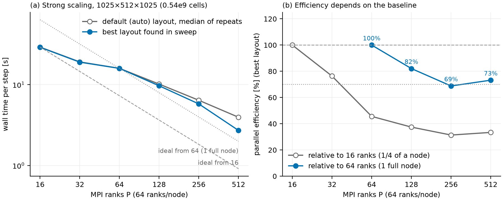
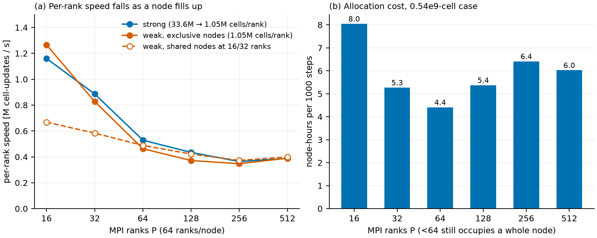
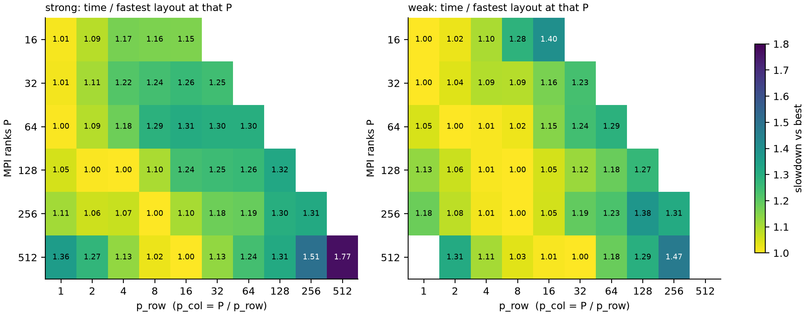
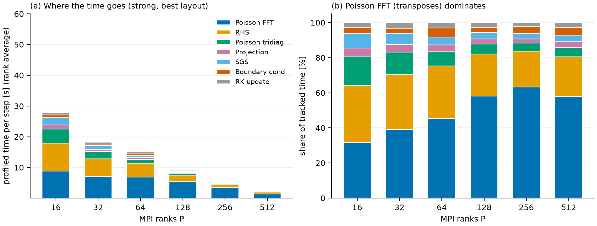

# Parallel Scaling

[← Home](Home.md)

How fast the single-phase solver runs on many MPI ranks, and how to choose the rank count and the `p_row × p_col` pencil layout. Everything below is measured on one machine with one case type, so read the numbers as guidance for planning, not as guarantees.

## Summary of guidelines

| Question | Guideline |
|---|---|
| How many cells per rank? | **4–8 M** for efficient runs (≈ 80 % efficiency); **1–2 M** when turnaround matters (≈ 70 %). Below 1 M was not tested. |
| How many ranks per node? | Fill whole nodes (here 64 ranks). A quarter-filled node is 3× faster per rank but wastes the rest of the node. |
| Which `p_row, p_col`? | Up to 64 ranks leave `0, 0` (automatic slab). Above 64 set them explicitly, `p_row` ≈ 4–16, `p_col = P / p_row`. |
| Layouts to avoid | `p_col = 1` (`p_row = P`) and `p_row ≥ 128`: 1.3–1.8× slower than the best layout. |
| Time-to-solution estimate | wall time per step ≈ cells / (ranks × 0.4 M s⁻¹) for 64 ranks and more (this case: AMD, wall model, no scalars). |

## What was measured

A wall-bounded channel (periodic in x and z, walls in y, AMD SGS model, wall model on, 30 time steps, no file output), run on 16 to 512 ranks of a cluster with 64 cores per node, one MPI rank per core, exclusive nodes.

* **Strong scaling:** fixed 1025 × 512 × 1025 grid (0.54 × 10⁹ cells), from 33.6 M cells/rank at 16 ranks down to 1.05 M at 512.
* **Weak scaling:** fixed 1.05 M cells/rank, grid grown with the rank count (2048 × 256 × 1024 at 512 ranks).
* **Decomposition sweep:** at every rank count, every valid `p_row × p_col` factor pair plus the automatic choice (112 runs in all).

Time per step is `Total wall time / steps`, so it includes start-up (about 5–10 % at 512 ranks). Each layout was run once, so differences below about 5 % should be read as ties. Repeats of the same layout differed by 0.3–1.5 % up to 128 ranks, 6 % at 256 and 9 % at 512.

## Result 1: efficiency depends on the baseline you pick

| Ranks | Cells/rank | s/step (auto layout) | s/step (best layout) | Efficiency vs 64 ranks, auto | Efficiency vs 64 ranks, best |
|--:|--:|--:|--:|--:|--:|
| 16 | 33.6 M | 29.0 | 29.0 | n/a | n/a |
| 32 | 16.8 M | 19.0 | 19.0 | n/a | n/a |
| **64** | 8.4 M | 15.9 | 15.9 | 100 % | 100 % |
| 128 | 4.2 M | 10.2 | 9.7 | 78 % | 82 % |
| 256 | 2.1 M | 6.2 | 5.8 | 64 % | 69 % |
| 512 | 1.05 M | 4.0 | 2.7 | 49 % | **73 %** |

Measured against 16 ranks the efficiency looks poor (31–45 %), but that is a node-packing effect rather than a communication cost. The 16-rank job runs a quarter-filled node, where each rank has the memory bandwidth to itself. Per-rank speed falls about 3× from 16 to 64 ranks on a node, then stays at 0.35–0.5 M cell-updates s⁻¹ per rank all the way to 512 (panel a below). Strong and weak runs give the same per-rank speed at equal rank count, so **the cell count per rank matters much less than how full the node is**.

So the honest baseline is one full node, and the figures above use it.

Weak scaling relative to 64 ranks (best layouts) is 86 % at 128, 76 % at 256 and 82 % at 512 ranks.

## Result 2: the cheapest run is one full node

Node-hours per 1000 steps for the 0.54 × 10⁹-cell case (panel b above):

| Ranks | 16 | 32 | **64** | 128 | 256 | 512 |
|---|--:|--:|--:|--:|--:|--:|
| Node-hours / 1000 steps | 8.0 | 5.3 | **4.4** | 5.4 | 6.4 | 6.0 |

Going from 1 node to 2 costs about 22 % more node-hours, and to 4 or 8 nodes about 40–45 % more, in exchange for a 1.6× to 5.9× shorter run (15.9 s to 2.7 s per step). Under-filling a node, as at 16 and 32 ranks, is the one clearly wasteful choice.

## Result 3: the pencil layout matters more as you add ranks

`p_row` splits x, `p_col` splits z, and y always stays local ([Input Parameters](Input-Parameters.md)). The automatic setting `0, 0` picks a z-slab (`p_row = 1`) whenever every rank keeps at least 2 z-cells. The heat map shows each layout's time relative to the fastest one at that rank count.

| Ranks | Auto layout | Best layout found | Gain of best over auto | Worst layout |
|--:|:--:|:--:|--:|:--:|
| 16 – 64 | 1 × P | 1 × P (weak 64: 2 × 32) | 0–1 % | 1.2–1.4× slower |
| 128 | 1 × 128 | 4 × 32 (2 × 64 equal) | 5 % | 1.32× slower (128 × 1) |
| 256 | 1 × 256 | 8 × 32 | 11 % | 1.31× slower (256 × 1) |
| 512 | 1 × 512 | **16 × 32** (8 × 64 within 3 %) | **46 %** | 1.77× slower (512 × 1) |

The 46 % at 512 ranks is far outside the run-to-run noise. Even against the faster of the repeated default runs the gain is 36 %.

The rule that follows from the data:

* **Up to 64 ranks:** leave `p_row = 0, p_col = 0`.
* **128 ranks and more:** set `p_row ≈ 4–16` and `p_col = P / p_row` (for example 4 × 32 at 128, 8 × 32 at 256, 16 × 32 at 512). The optimum is broad: within one step of it, a layout is within about 2–10 % of the best.
* **Never** use `p_col = 1` or `p_row ≥ 128`. Pure slabs at large P also hit the solver's pencil-size limits (the weak 512 case rejects both 1 × 512 and 512 × 1).
* **Check what the solver picked.** For the weak 512 case (2048 × 256 × 1024) the automatic choice is already 32 × 16, the best layout, because the x:z aspect ratio is 2:1. Auto falls back to the slab whenever a slab is allowed, which is what costs performance for the 0.54 × 10⁹ strong case at 128 ranks and more.

The layout is a pure performance choice. Final divergence was about 10⁻¹² for every layout, with no sensitivity to the decomposition (the cross-layout agreement is also checked in the [consistency suite](Validation.md#a1-regression-and-consistency-suite)).

## Result 3b: why large P stops scaling

The Poisson FFT, whose cost is the pencil transposes, grows from about 32 % of the profiled time at 16 ranks to 58–63 % at 128 ranks and above. The right-hand-side evaluation shrinks the fastest with rank count (31 % to 19 %), and the tridiagonal solve and SGS share drop to a few percent. This is why the decomposition matters most at large P, since the layout sets the transpose volume, and it is what limits scaling beyond roughly 256 ranks for this grid.

## Practical recommendations

1. **Pick the rank count from the cell count.** Aim for 4–8 M cells per rank. For the 0.54 × 10⁹ case that is 64–128 ranks, at 80 % efficiency or better. Go to 1–2 M cells per rank (256–512 ranks here) only when turnaround matters, and expect about 70 % efficiency and 1.4–1.5× the node-hours.
2. **Use whole nodes.** Request a multiple of the cores per node. Jobs that share a node with other users were about 2× slower in these tests at 16 and 32 ranks, so do not compare timings between the two allocation policies.
3. **Set `p_row`/`p_col` above 64 ranks**, following the rule in Result 3.
4. **Do a short benchmark before a long run.** Ten steps at two or three candidate layouts cost a few minutes and are worth up to 35–45 % at 512 ranks. Compare the profiler's per-stage times, not only the total.
5. **Estimate run time** as `cells / (ranks × 0.4 × 10⁶)` seconds per step for 64 ranks or more, and multiply by the number of steps. Use it for budgeting only. The coefficient applies to this machine and this physics set, and other options (scalars, particles, two-phase VOF, a GPU build) cost more per cell and were not measured here.

## Limits of this study

* Single machine type with 64 cores per node, and a single case type (channel, AMD, wall model). The scalar, particle, immersed-boundary and two-phase paths were not benchmarked.
* One measurement per layout and 30 steps, including start-up. The best layout is a minimum over many runs, so its gain is slightly optimistic. Differences under about 5 % are not significant.
* Strong scaling was run on one grid shape. Below about 1 M cells per rank was not tested, and the FFT transposes already take about 60 % of the time there.
* No multi-GPU scaling is included. See [Installation](Installation.md) for the status of the GPU build.

## Data and scripts

Run summary: [`assets/scaling/scaling_summary.csv`](assets/scaling/scaling_summary.csv). The raw logs, the 112-run table, the analysis scripts (`parse_all.py`, `make_figures.py`) and the case generators (`setup_scaling.sh`, `decomposition_sweep/setup_decomp_sweep.py`) are in `validation/scaling/` on the cluster storage.
