# Validation

[← Home](Home.md)

This page keeps two kinds of evidence apart:

* **Numerical correctness** (Part A): the code does what the equations say. Exact or analytic solutions, conservation, convergence, and consistency between rank layouts, restarts and the CPU and GPU builds. None of these says anything about how well the model represents a physical flow.
* **Validation against reference data** (Part B): the simulated flow is compared with DNS or experiment, with the error measure quoted next to each figure.

| Level | Evidence | Where |
|:--:|---|---|
| **V0** | Consistency: results independent of rank count, pencil layout, restart and CPU/GPU build | [A.1](#a1-regression-and-consistency-suite) |
| **V1** | Verification: exact solutions, analytic limits, observed convergence | [A.2](#a2-exact-and-analytic-checks) |
| **V2** | Validation: quantified error against DNS or experiment | [Part B](#part-b-validation-against-reference-data) |

All quantities are nondimensional unless units are given. Figures are generated by the scripts in
[`postProcessing/validation/`](../postProcessing/validation); the JSON next to each PNG in `docs/assets/validation/` holds the curves and
error measures quoted below. Animations illustrate the flow; they are not accuracy evidence.

## Status by pathway

| Pathway | Numerical correctness | Validation against reference | Status |
|---|---|---|---|
| Single-phase DNS, central divergence-form advection | V0 (`tgv_small`) | Taylor–Green vortex, Re = 1600, Incompact3d DNS: [B.1](#b1-taylorgreen-vortex-re--1600) | Validated |
| Flat-wall equilibrium wall model, Vreman LES | V0 (`chan*`), V1 log-law decay (`wm_stream`, `wm_stream_rough`) | Channel Re<sub>τ</sub> = 395, Moser–Kim–Mansour: [B.2](#b2-wall-modelled-channel-reτ--395) | Validated (mean profile and stresses) |
| AMD SGS model (default) | V0 | Channel Re<sub>τ</sub> = 2000 and 5200 against Lee and Moser: [B.3](#b3-amd-and-vreman-at-reτ--2000-and-5200) | Validated (bulk velocity and mean profile) |
| Ghost-cell IBM | V0 (`ibm_*`) | Wavy wall, Re<sub>H</sub> = 6760, Maaß and Schumann DNS: [B.4](#b4-flow-over-a-wavy-wall-ibm) | Validated |
| Staircase IBM with wall model | V0, V1 (`ibm_stair_plate`) | none in this suite | Verified |
| Boussinesq temperature | V0 (`bouss*`) | Rayleigh–Bénard, Kunnen et al. (2009): [B.5](#b5-rayleighbénard-convection) | Validated (mean temperature) |
| MOST thermal wall | V0, V1 (`wm_thermal`) | none in this suite | Verified |
| UAV actuator disk | V0 (`uav*`) | Vortex-cylinder theory, hover: [B.7](#b7-actuator-disk-in-hover) | Compared with theory |
| PLIC-VOF transport, surface tension, gravity waves | V0, V1 ([A.2](#a2-exact-and-analytic-checks)) | none in this suite | Verified |
| VOF waves, breaking, IBM beach | V0 (`vof_*`) | Ting and Kirby (1994) spilling breaker: [B.6](#b6-spilling-breaker-ting-and-kirby-1994) | Compared with experiment |
| Lagrangian particles | V0 (`part_*`) | One-way-coupled inertial particles, $St^+=1$ and 5, Marchioli et al. (2008): [B.8](#b8-inertial-particles-in-channel-flow) | Validated (inside the benchmark envelope) |
| SEM and recycled inflow | V0 (`sem*`, `verify_sem_divergence_free`) | none in this suite | Consistency-tested |
| Urban IBM, wall model, recycled inflow | V0 (`ibm_*`, `sem*`) | Michel-Stadt, SOD2D and wind tunnel: [B.9](#b9-urban-flow-michel-stadt) | Compared with reference (mean and rms profiles) |
| Sediment, rotation | V0 | none in this suite | Consistency-tested |
| CPU/GPU builds, multi-rank | V0 | n/a | See [A.1](#a1-regression-and-consistency-suite) |

*Verified* means V1 evidence exists, *Validated* means V2 evidence with the error quoted, *Consistency-tested* means V0 only.

# Part A. Numerical correctness

## A.1 Regression and consistency suite

`ctest` registers 220 tests in the CPU build and 325 in the GPU build (the GPU build adds the CPU-versus-GPU comparisons). The cases in
`tests/regression/` cover TGV, LES and DNS channels, the 4-wall duct, inflow/outflow (constant, SEM, recycled), passive scalar, Boussinesq
temperature, sediment, UAV actuator disk, ghost-cell and staircase IBM, higher-order advection, point particles, the two-fluid solver and
input-validation aborts. Each case is run on:

* 1 rank and on 2 ranks, plus the explicit 4-rank `2x2` and `4x1` pencil layouts (particles also on 3 ranks);
* a hot-start restart compared with an uninterrupted run;
* in a GPU build, the same layout on the CPU reference build, which agrees to round-off (about 1e-13).

Agreement is required on the per-step monitor diagnostics and field by field on the final snapshot. The test names are
`<case>_<kind>_np1_vs_np4_<layout>`, `<case>_cpu_vs_gpu_np<N>` and `<case>_restart_np<N>`. Details and the debugging tools are in
[Installation](Installation.md#testing) and [Development](Development.md#decomposition-consistency-cpu--multi-cpu--gpu--multi-gpu).

## A.2 Exact and analytic checks

| Check | Test or case | Result |
|---|---|---|
| Log-law decay of a uniform stream over a wall-modelled plate | `wm_stream`, `wm_stream_rough`, `ibm_stair_plate` | decays as the integrated log law; the staircase-IBM plate also has round-off divergence |
| MOST heat flux | `wm_thermal` | heat flux of the Monin–Obukhov law |
| Laplace pressure jump, 2-D disk and 3-D sphere, 1000:1 | `vof_drop_small_laplace`, [VOF §3.2](Two-Phase-VOF.md#32-surface-tension) | error 0.8 % to 0.2 % (disk, N = 32 to 64), 1.0 % to 0.4 % (sphere, N = 24 to 32); parasitic velocity below 3e-5 in the test |
| Capillary wave and sloshing frequency | `vof_capwave_small_frequency`, `vof_slosh_small_frequency` | within 1 % of linear theory |
| Interface advection, LeVeque vortex (L1) | [VOF §3.1](Two-Phase-VOF.md#31-interface-transport-prescribed-velocity-full-solver-pipeline) | 8.5e-3, 9.8e-4, 6.7e-5 at N = 32, 64, 128 |
| Interface advection, Zalesak slotted disk (L1) | `examples/vof_zalesak_disk` | 3.5 % and 1.1 % of the disk area at N = 100 and 256 |
| Standing gravity wave, 1000:1, frequency error | [VOF §3.3](Two-Phase-VOF.md#33-gravity-waves-10001) | −0.43 %, −0.32 %, −0.23 % at N = 32, 64, 128 |
| Interface stress transfer (Rayleigh problem) | [VOF §3.4](Two-Phase-VOF.md#34-stress-transfer-across-the-interface) | 94 % of the exact momentum once the gas layer spans 7 cells |
| Liquid volume and `C` bounds | all two-fluid runs | drift ≤ 3e-15, `C` in [0,1] without clipping |

# Part B. Validation against reference data

## B.1 Taylor–Green vortex, Re = 1600

Decay of the Taylor–Green vortex in the periodic box $(2\pi)^3$ at $Re=1600$ with `sgs_model = 0` (DNS), `advection_scheme = 1` and grids of
$256^3$, $384^3$ and $512^3$. The reference is the Incompact3d $512^3$ DNS. The error measure is the root-mean-square difference of
$\epsilon=-\mathrm{d}E_k/\mathrm{d}t$ over $0.5\le t\,U_0/L\le20$, normalised by the DNS peak, and the relative difference of the peak.

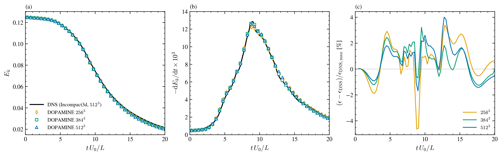

**Figure 1.** Taylor–Green vortex, Re = 1600. (a) kinetic energy, (b) dissipation rate $-\mathrm{d}E_k/\mathrm{d}t$, (c) difference from the DNS dissipation normalised by the DNS peak. Black line: DNS; markers: DOPAMINE, every second output.

| Grid | $\epsilon_\mathrm{max}\times10^3$ | peak error | $t$ of peak | L2 error of $\epsilon$ | L2 error of $E_k$ |
|---|---|---|---|---|---|
| DNS | 12.9 | | 8.98 | | |
| $256^3$ | 12.2 | −5.0 % | 9.07 | 1.65 % | 0.68 % |
| $384^3$ | 12.8 | −0.7 % | 9.00 | 1.23 % | 0.85 % |
| $512^3$ | 12.6 | −1.7 % | 9.00 | 1.41 % | 0.91 % |

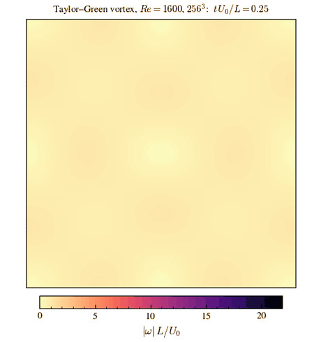

**Animation.** Vorticity magnitude on the plane $z=0.2L_z$, $256^3$.

Reproduce:

```sh
python3 postProcessing/validation/plot_tgv.py --case <validation>/tgv --out docs/assets/validation/tgv
python3 postProcessing/validation/animate_validation.py tgv --out docs/assets/validation/tgv/tgv_vorticity.gif --every 3
```

## B.2 Wall-modelled channel, Re<sub>τ</sub> = 395

Channel flow, periodic in $x$ and $z$, $66\times65\times66$ cells, Vreman SGS model and the equilibrium log-law wall model on both walls
(`flat_wall_model_flag = 1`), $\nu=1/395$, constant pressure gradient $\mathrm{d}P/\mathrm{d}x=1$ ($u_\tau=1$). Statistics are averaged over steps
80 000–120 000 and over the two halves. The reference is the Moser, Kim and Mansour (1999) DNS at $Re_\tau=392$.

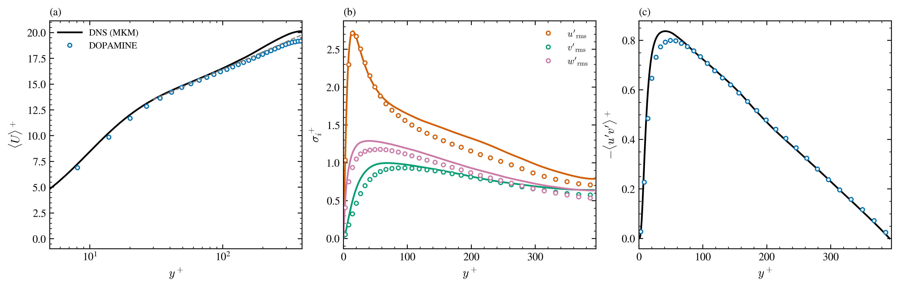

**Figure 2.** Wall-modelled LES of channel flow at $Re_\tau=395$. (a) mean velocity (dashed grey: $U^+=\kappa^{-1}\ln y^++5.2$, $\kappa=0.41$), (b) rms velocity fluctuations, (c) Reynolds shear stress. Lines: MKM DNS; markers: DOPAMINE.

| $y^+$ | 50 | 100 | 200 | 395 |
|---|---|---|---|---|
| $U^+$ DNS | 14.86 | 16.53 | 18.55 | 20.13 |
| $U^+$ DOPAMINE | 14.72 | 16.29 | 17.91 | 19.19 |

The bulk velocity is 16.53 against 17.06 for the DNS (−3.2 %).

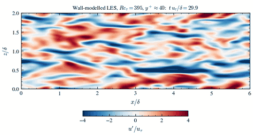

**Animation.** Streamwise velocity fluctuation $u'/u_\tau$ on the plane $y^+\approx40$.

Reproduce:

```sh
python3 postProcessing/validation/plot_channel_wm.py --chan395 <validation>/chan395 --amdwl <validation>/AMDWallLayer \
        --out docs/assets/validation/channel
python3 postProcessing/validation/animate_validation.py chan395 --out docs/assets/validation/channel/channel395_streaks.gif --every 3
```

## B.3 AMD and Vreman at Re<sub>τ</sub> = 2000 and 5200

Wall-modelled half channels on a $64^3$ grid with the wall-model temporal filter on (`wm_filter_mode = 1`) and the rough-wall log law. The first
cell centre is at $y^+=15.9$ ($Re_\tau=2000$) and $y^+=41$ ($Re_\tau=5200$). The reference is the Lee and Moser (2015) DNS. The averaging
windows are 27.9 (AMD, 2000), 23.2 (Vreman, 5200) and 27.0 (AMD, 5200) time units.

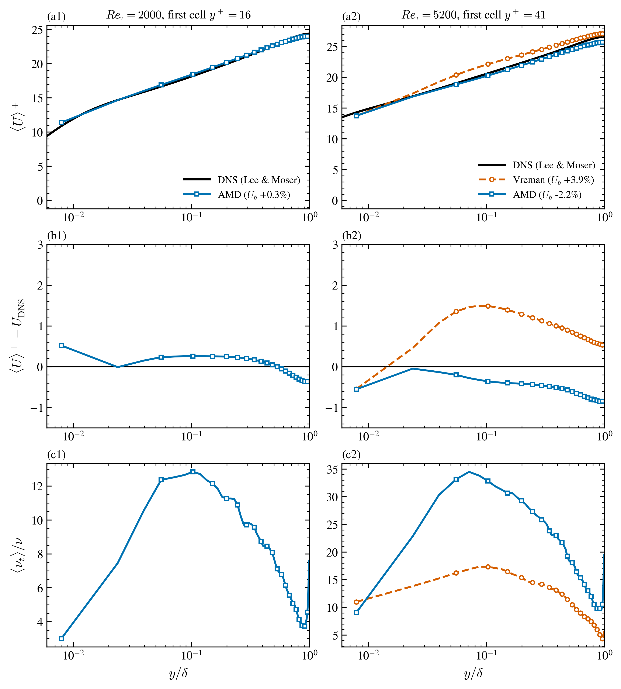

**Figure 3.** Wall-modelled LES at $Re_\tau=2000$ (left) and 5200 (right). (a) mean velocity, (b) difference from the DNS profile, (c) mean eddy viscosity. Black: Lee and Moser DNS; blue squares: AMD; orange circles: Vreman.

| $Re_\tau$ | first cell $y^+$ | SGS model | bulk velocity | error |
|---|---|---|---|---|
| 2000 | 15.9 | AMD | 21.81 (DNS 21.75) | +0.3 % |
| 5200 | 41 | Vreman | 25.01 (DNS 24.08) | +3.9 % |
| 5200 | 41 | AMD | 23.54 | −2.2 % |

Reproduce: as for [B.2](#b2-wall-modelled-channel-reτ--395) (same script, second figure).

## B.4 Flow over a wavy wall (IBM)

Turbulent channel flow over a sinusoidal wall, $2a/\lambda=0.10$, $Re_H=6760$, DNS on $258\times129\times130$ cells with the ghost-cell immersed boundary. Statistics are averaged over 113 snapshots covering 226 time units, over the span and over the four periodic wavelengths. The
reference is the Maaß and Schumann DNS (ERCOFTAC wavy-wall case). Errors are L2 norms over each profile, $U$ and $V$ normalised by $U_b$ and
the stresses by their maximum in the DNS profile.

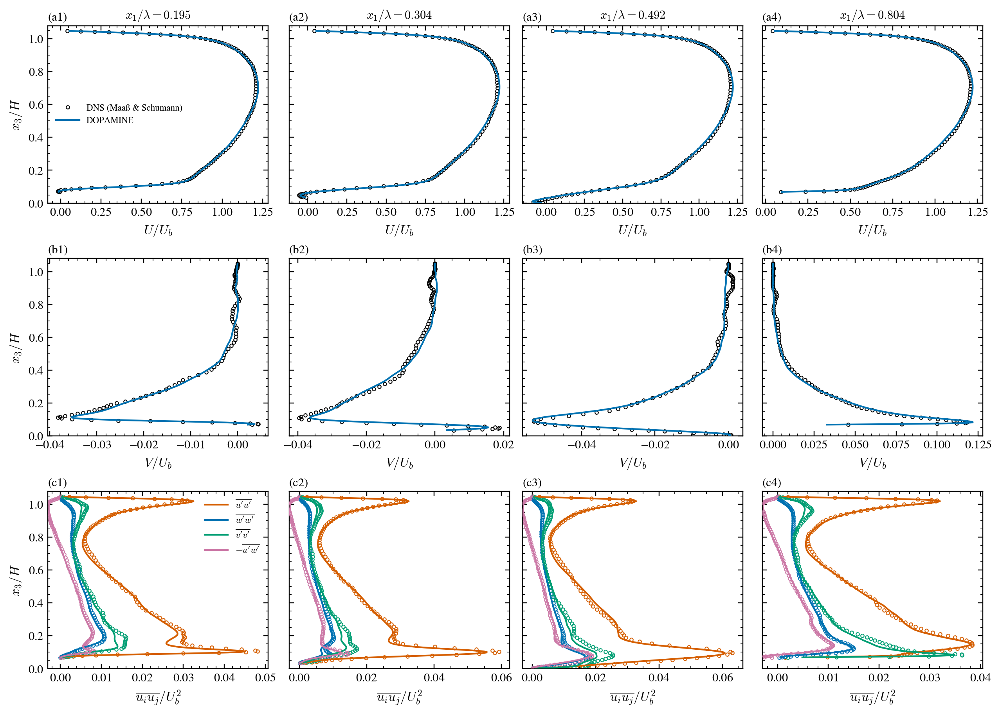

**Figure 4.** Flow over a wavy wall at four stations $x_1/\lambda$. Columns: (a) streamwise velocity, (b) vertical velocity, (c) Reynolds stresses ($\overline{u'u'}$, $\overline{w'w'}$, $\overline{v'v'}$, $-\overline{u'w'}$). Circles: DNS of Maaß and Schumann; lines: DOPAMINE.

| $x_1/\lambda$ | L2($U$)/$U_b$ | L2($V$)/$U_b$ | $\overline{u'u'}$ | $\overline{w'w'}$ | $\overline{v'v'}$ | $-\overline{u'w'}$ |
|---|---|---|---|---|---|---|
| 0.195 | 1.9 % | 0.14 % | 4.2 % | 3.2 % | 6.0 % | 3.5 % |
| 0.304 | 1.2 % | 0.23 % | 3.2 % | 8.7 % | 8.8 % | 5.9 % |
| 0.492 | 1.1 % | 0.17 % | 2.9 % | 4.3 % | 7.5 % | 3.1 % |
| 0.804 | 0.85 % | 0.33 % | 2.9 % | 2.4 % | 3.4 % | 2.4 % |

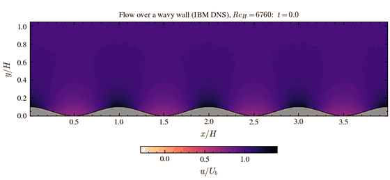

**Animation.** Streamwise velocity on the mid-span plane.

Reproduce:

```sh
python3 postProcessing/validation/plot_wavywall.py --case <validation>/waveWall --out docs/assets/validation/wavywall
python3 postProcessing/validation/animate_validation.py wavywall --out docs/assets/validation/wavywall/wavywall_velocity.gif --every 18
```

## B.5 Rayleigh–Bénard convection

Boussinesq convection between isothermal plates, $130\times65\times130$ cells, $Pr=1$, $Ra=2.5\times10^6$, DNS. The mean temperature is averaged over the horizontal
plane and over 150 snapshots (75 time units). The reference is the mean temperature profile of Kunnen, Geurts and Clercx (2009).

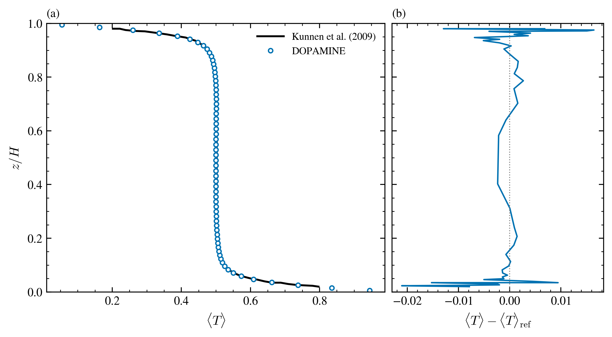

**Figure 5.** Mean temperature in Rayleigh–Bénard convection. (a) profile, (b) difference from the reference. Dashed line: Kunnen, Geurts and Clercx (2009); markers: DOPAMINE.

The L2 difference over the 47 reference points is 0.0063 and the largest difference 0.021 (at $z/H=0.023$). The mid-height temperature is 0.5001
against 0.5025 in the reference.

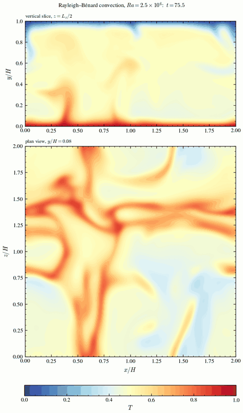

**Animation.** Temperature on the mid-span vertical slice and on the plan view at $y/H=0.08$, showing plumes rising from the hot plate and the sheet-like convection cells.

Reproduce:

```sh
python3 postProcessing/validation/plot_rb.py --case <validation>/RBconvection --out docs/assets/validation/rb
python3 postProcessing/validation/animate_validation.py rb --out docs/assets/validation/rb/rb_convection.gif --every 8
```

## B.6 Spilling breaker, Ting and Kirby (1994)

Regular waves ($T=2$ s, $H=0.125$ m, depth $h=0.40$ m) shoaling and breaking on a 1:35 plane beach. The two-fluid solver (PLIC-VOF, 1000:1) uses
the Vreman SGS model, an immersed-boundary beach with the log-law wall model, a stream-function wave inlet with a generation zone and an absorbing
beach at the outlet (`examples/tingkirby94_spillingwaves`). The medium grid is $2000\times161\times20$ cells. Statistics are phase averages over
the last 19 whole wave periods after $t=40$ s. The reference is the digitised data of Ting and Kirby (1994, Figs. 4 to 6): wave crest, mean level
and trough, and the mean and rms velocity at four LDA stations.

> **Note on the expected level of agreement.** The spilling breaker has relatively low turbulence levels (the measured rms velocity stays below
> about $0.06\sqrt{gh}$ in the stations shown). Resolved LES turbulence has little to represent, and the rms comparison is therefore
> expected to be less good than for the strongly turbulent cases above. The surface elevation and the mean flow are the primary targets here.

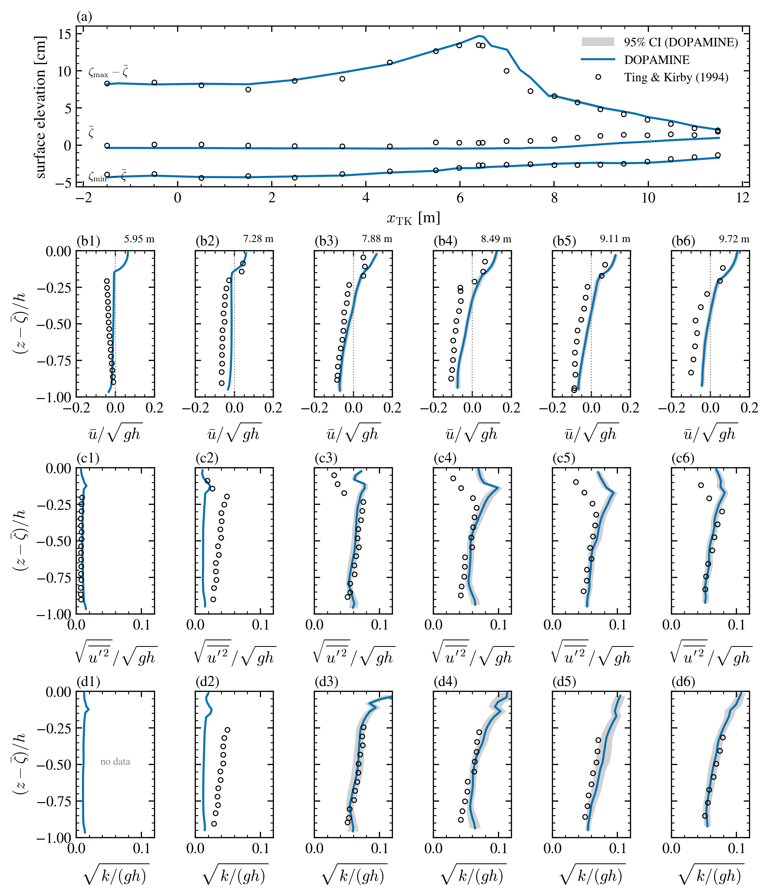

**Figure 6.** Spilling breaker. (a) crest and trough elevation about the mean and mean level against the streamwise position $x_\mathrm{TK}$; (b) mean velocity and (c) rms of the velocity fluctuation at four LDA stations, with $h$ the local mean depth. Blue lines: DOPAMINE; grey band: 95 % confidence interval of the phase-averaged DOPAMINE statistics over the 19 periods (Student-$t$, $t_{0.975,18}\,\sigma/\sqrt{19}$); circles: Ting and Kirby (1994).

| Quantity | DOPAMINE | Experiment |
|---|---|---|
| Maximum wave height | 17.8 cm at $x_\mathrm{TK}=6.40$ m | 16.5 cm at 5.99 m |
| RMS difference, wave height (all stations) | 1.05 cm | |
| RMS difference, mean level | 0.83 cm | |
| Median 95 % CI half-width of the wave height (crest plus trough) | 0.14 cm | |

| Station $x_\mathrm{TK}$ [m] | 5.95 | 7.28 | 8.49 | 9.72 |
|---|---|---|---|---|
| RMS difference of the mean velocity / $\sqrt{gh}$ | 0.022 | 0.039 | 0.045 | 0.056 |
| RMS of the experimental mean velocity / $\sqrt{gh}$ | 0.031 | 0.055 | 0.080 | 0.070 |
| RMS difference of the rms fluctuation / $\sqrt{gh}$ | 0.0021 | 0.023 | 0.018 | 0.015 |
| RMS of the experimental rms fluctuation / $\sqrt{gh}$ | 0.0074 | 0.035 | 0.053 | 0.061 |

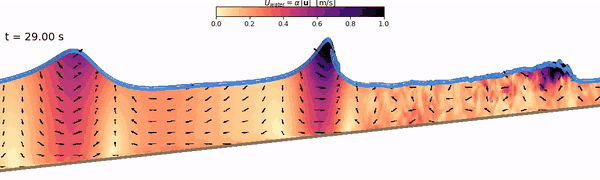

**Animation.** Velocity magnitude of the water, $\alpha|\mathbf{u}|$, on the centre plane through the surf zone (vertical scale ×4).

Reproduce:

```sh
python3 postProcessing/validation/plot_tk94.py --case <validation>/voftest/tk94_spilling --run medium --t0 40 \
        --out docs/assets/validation/tk94
```

## B.7 Actuator disk in hover

A static, uniformly loaded actuator disk (`uav_load_profile = 0`, $R=0.1$ m, `uav_kernel_ncell = 2`) in a quiescent free-slip box of
$1\times2\times1$ m, with the thrust set for a hover induced velocity $v_h=1$ m/s. The vertical velocity along the axis is averaged over
$t=2$ to 6 s and compared with the closed-form vortex-cylinder solution (Leishman, *Principles of Helicopter Aerodynamics*, §2.4)
$-V/v_h = 1+s/\sqrt{s^2+R^2}$, with $s$ the axial distance from the disk, positive into the wake. Three resolutions, $R/\Delta y=3.2$, 6.4 and 9.6, were run.

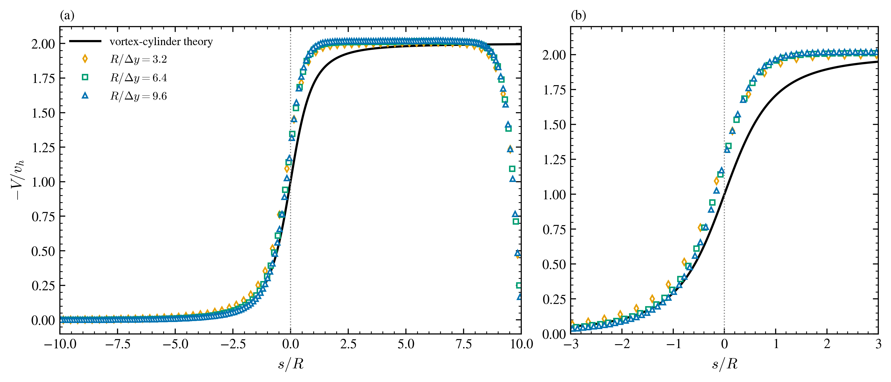

**Figure 7.** Actuator disk in hover. (a) axial velocity along the axis for three resolutions, (b) enlargement of $|s/R|\le3$. Black line: vortex-cylinder theory; markers: DOPAMINE.

| $R/\Delta y$ | RMSE, $\lvert s/R\rvert\le3$ | RMSE, $\lvert s/R\rvert\le0.5$ | far wake $-V/v_h$ ($3\le s/R\le6$) |
|---|---|---|---|
| 3.2 | 0.153 | 0.260 | 2.004 |
| 6.4 | 0.154 | 0.245 | 2.013 |
| 9.6 | 0.159 | 0.247 | 2.019 |

Reproduce:

```sh
python3 postProcessing/validation/plot_adm.py --case <validation>/adm --out docs/assets/validation/adm
```

## B.8 Inertial particles in channel flow

One-way-coupled heavy point particles ($\rho_p/\rho_f=769.9$, $St^+=1$ and 5, $d^+=0.153$ and 0.342) in a DNS channel at $Re_\tau=150$ ($\nu=1/150$,
$4\pi\times2\times2\pi$, $192\times160\times128$ cells with the tanh clustering of the benchmark), following the benchmark of Marchioli et al. (2008).
$10^5$ particles are seeded uniformly, with Stokes drag and the Schiller–Naumann correction and reflecting walls. The reference curves are digitised from the
benchmark paper; the grey band is the minimum to maximum over its participating groups. Statistics are pooled over the snapshots in $t^+=18\,000$ to
20 250 ($St^+=1$, 8 snapshots) and $t^+=12\,000$ to 14 100 ($St^+=5$, 7 snapshots, the end of that run), in slabs of the benchmark's width.
The fluid statistics are from the last six snapshots of the particle-free flow, with the MKM $Re_\tau=180$ DNS as an additional curve.

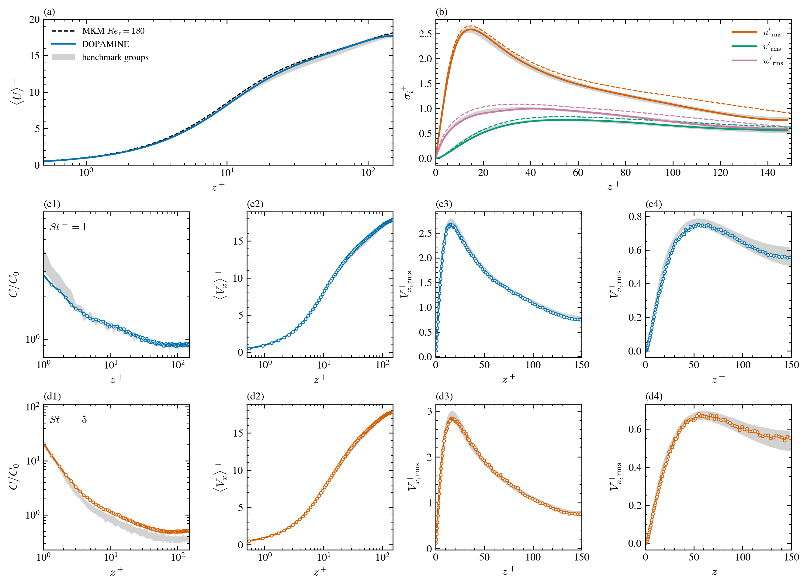

**Figure 8.** Inertial particles in channel flow. (a) fluid mean velocity and (b) fluid rms velocity (solid: DOPAMINE; dashed: MKM $Re_\tau=180$); rows (c) $St^+=1$ and (d) $St^+=5$: concentration $C/C_0$, mean streamwise particle velocity, streamwise and wall-normal particle rms, against the benchmark group envelope (grey).

The score is the share of slabs with $1\le z^+\le150$ inside the benchmark envelope, widened by 30 % for the concentration, 5 % for the mean velocity and 10 % for the rms,
and the rms difference from the envelope centre line.

| Quantity | Fluid | $St^+=1$ | $St^+=5$ |
|---|---|---|---|
| Mean velocity | 100 %, 1.9 % | 100 %, 1.8 % | 100 %, 1.4 % |
| $u$ rms | 100 %, 2.7 % | 100 %, 4.4 % | 98.9 %, 4.8 % |
| $v$ rms | 100 %, 7.5 % | 97.8 %, 9.2 % | 92.5 %, 9.1 % |
| $C/C_0$ | n/a | 100 %, 5.1 % | 94.6 %, 37 % |

(share inside the envelope, rms difference). The $St^+=5$ run ends at $t^+=14\,100$ whereas the benchmark profile is the instant $t^+=20\,000$; its
concentration is still increasing at the end of the run and lies above the envelope for $z^+\gtrsim10$.

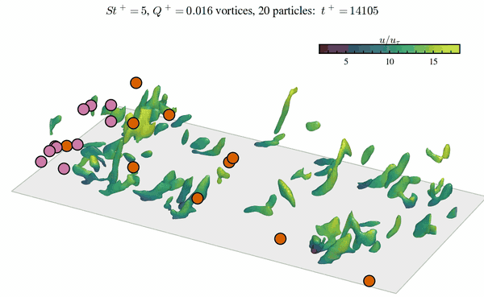

**Animation.** Vortical structures (isosurface $Q^+=0.016$ below $y^+=90$, coloured by the streamwise velocity $u/u_\tau$) and 20 $St^+=5$ particles with fading tracks, $t^+\approx14\,100$ to 14 260. Orange: 10 particles in the buffer layer ($y^+<15$); pink: 10 particles at $15<y^+<45$. The animation comes from a short restart of the $St^+=5$ run with a snapshot every 5 $t^+$.

Reproduce:

```sh
python3 postProcessing/validation/plot_particles.py --case <validation>/particleValidation --out docs/assets/validation/particles
python3 postProcessing/validation/animate_validation.py particles3d --out docs/assets/validation/particles/particles_3d.gif --every 1 --fps 9 --colors 96
```

## B.9 Urban flow, Michel-Stadt

The Michel-Stadt configuration of the CEDVAL-LES / COST ES1006 benchmark (flat roofs, wind direction 0°, full scale, building height $H=24$ m,
$U_\mathrm{ref}=6.1$ m/s), compared with the spectral-element LES of Teng et al. (2025, SOD2D, case 2) and with the wind-tunnel points of Leitl and Harms as
plotted there. The domain is $1997.5\times240\times1277.5$ m, periodic in $z$ with a free-slip lid. The solver uses the staircase IBM (`ibm_pressure = 2`),
`advection_scheme = 2`, a rough-wall log-law model on the ground ($z_0=0.05$ m) and on the building walls and roofs, and recycled inflow from a periodic
roughness-cube precursor (`inflow_type = 2`).

| Run | SGS model | cells | $\Delta x=\Delta z$ | $\Delta y$ (to 30 m) | averaging window |
|---|---|---|---|---|---|
| Coarse | Vreman | $800\times62\times512$ (24.9 M) | 2.5 m | 1.25 m | 1000–2494 s |
| Coarse | AMD | $800\times62\times512$ (24.9 M) | 2.5 m | 1.25 m | 1000–2494 s |
| Fine | AMD | $1600\times129\times1024$ (199.6 M) | 1.25 m | 0.625 m | 301–990 s |

Profiles are taken on the centre plane at seven of the benchmark stations. The shading is the 95 % confidence interval of the mean or rms of each run,
with the sample size reduced by the autocorrelation of the signal.

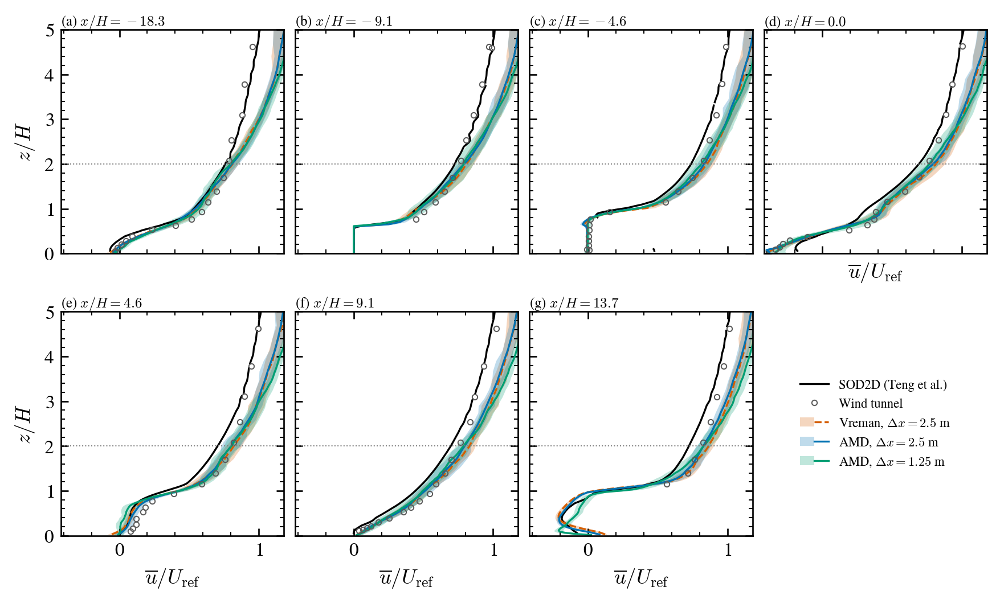

**Figure 9.** Mean streamwise velocity $\bar u/U_\mathrm{ref}$ against $z/H$ at seven stations along the street axis (x/H measured from the first building). Black line: SOD2D; circles: wind tunnel; orange dashed: Vreman, $\Delta x=2.5$ m; blue: AMD, 2.5 m; green: AMD, 1.25 m; bands: 95 % confidence intervals; dotted line: $z/H=2$.

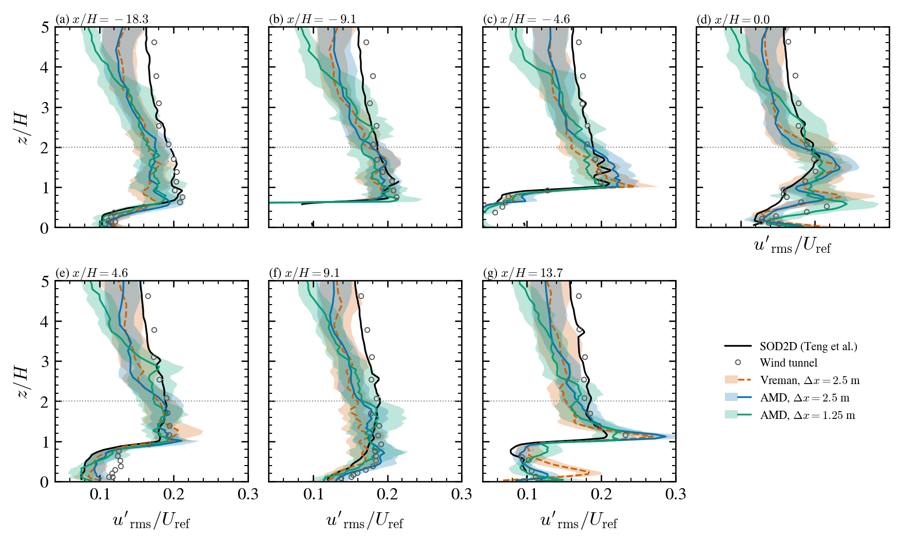

**Figure 10.** Streamwise rms velocity $u'_\mathrm{rms}/U_\mathrm{ref}$ at the same stations, with the same symbols.

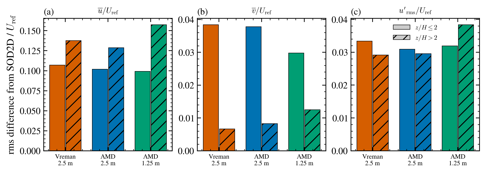

**Figure 11.** Rms difference from the SOD2D profiles, normalised by $U_\mathrm{ref}$, for (a) mean $u$, (b) mean $v$ and (c) $u_\mathrm{rms}$, separately for $z/H\le2$ and $z/H\gt2$ (hatched).

| Rms difference from SOD2D / $U_\mathrm{ref}$ | band | Vreman 2.5 m | AMD 2.5 m | AMD 1.25 m |
|---|---|---|---|---|
| mean $u$ | $z/H\le2$ | 0.107 | 0.102 | 0.099 |
| mean $u$ | $z/H\gt2$ | 0.138 | 0.129 | 0.158 |
| mean $v$ | $z/H\le2$ | 0.038 | 0.038 | 0.030 |
| mean $v$ | $z/H\gt2$ | 0.007 | 0.008 | 0.013 |
| $u_\mathrm{rms}$ | $z/H\le2$ | 0.033 | 0.031 | 0.032 |
| $u_\mathrm{rms}$ | $z/H\gt2$ | 0.029 | 0.030 | 0.038 |

The grid is coarser than the 0.75 m resolution used by the 4th-order spectral-element reference inside the canopy, which limits how closely the
street-level profiles can match it. Halving the cell size changes the profiles by about 0.04 $U_\mathrm{ref}$ (mean $u$ and $v$ below $z/H=2$) and
lowers the difference from SOD2D in the mean $u$ (0.102 to 0.099) and the mean $v$ (0.038 to 0.030) below $z/H=2$; with two resolutions no order of
convergence is derived.

Above $z/H=2$ the simulated mean velocity exceeds both references by 0.12 to 0.14 $U_\mathrm{ref}$ at all stations, and the same offset (0.115 to 0.126)
is already present at the upstream station (a), ahead of the first building. The inflow profile is therefore not identical to that of the reference, and
the difference above $z/H\gt2$ comes from it, not from the flow through the city. It is the same for the three runs.

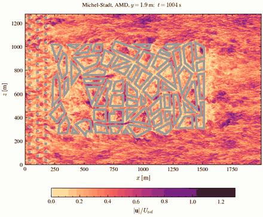

**Animation.** Velocity magnitude $|\mathbf{u}|/U_\mathrm{ref}$ at $y=1.9$ m, coarse AMD run, from $t\approx1000$ s. Grey: solid cells of the staircase IBM at that height (from the signed-distance field), so the open courtyards inside the building blocks show the flow.

Reproduce:

```sh
python3 postProcessing/validation/animate_validation.py urban --out docs/assets/validation/michelstadt/michelstadt_flow.gif \
        --every 5 --nframes 20 --colors 32
python3 postProcessing/validation/plot_michelstadt.py --root /mnt/storage3/voxel/MichelStadt \
        --out docs/assets/validation/michelstadt
```

The wind-tunnel data and the case are from the COST Action ES1006 benchmark and its data policy asks that the Action be acknowledged.

## Data and scripts

`<validation>` is the directory holding the simulation output (`/mnt/storage1/fdm-dopamine/validation` for the runs reported here). Common figure
style: [`plotstyle.py`](../postProcessing/validation/plotstyle.py); GIFs are encoded by `postProcessing/animations/anim_common.py` with a 64-colour
palette at 6 to 9 frames per second to keep each file near 1 MB.

**References.** Moser, Kim and Mansour (1999), *Phys. Fluids* 11, 943. Lee and Moser (2015), *J. Fluid Mech.* 774, 395. Kunnen, Geurts and
Clercx (2009), *J. Fluid Mech.* 642, 445. Ting and Kirby (1994), *Coastal Eng.* 24, 51. Maaß and Schumann (1996), *Direct numerical simulation of
separated turbulent flow over a wavy boundary*. Leishman (2006), *Principles of Helicopter Aerodynamics*. Brachet et al. (1983), *J. Fluid Mech.* 130, 411. Marchioli et al. (2008), *Int. J. Multiphase Flow* 34, 879. Teng et al. (2025), arXiv:2502.13672. Leitl and Harms, CEDVAL-LES wind-tunnel data (COST ES1006).
